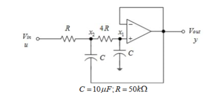
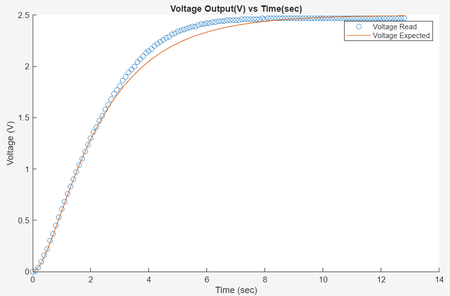
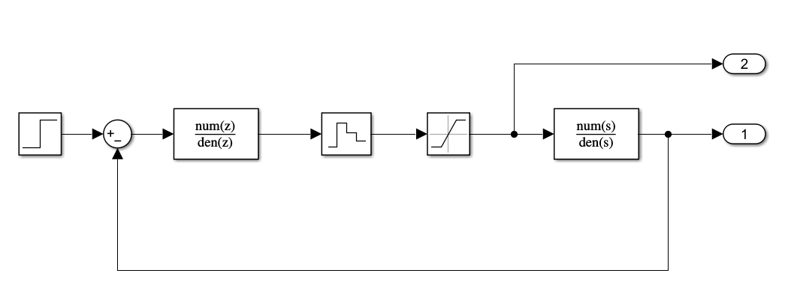
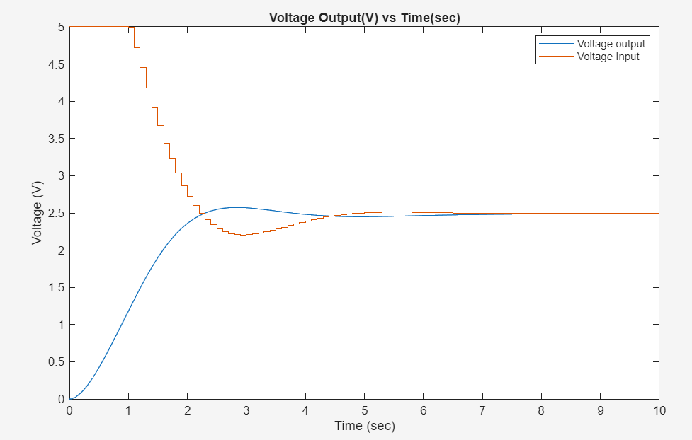
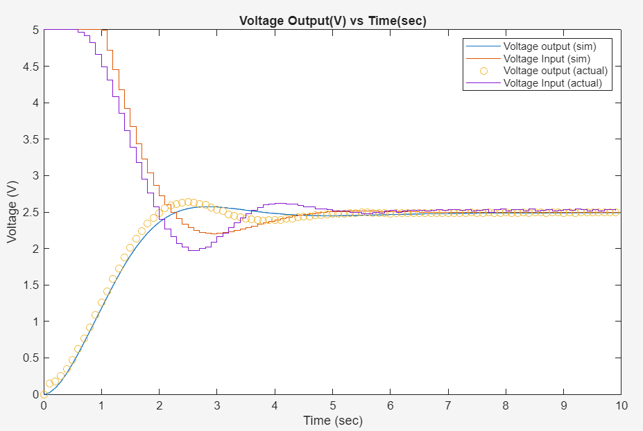
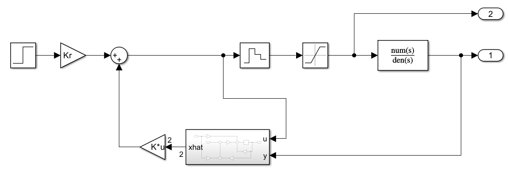
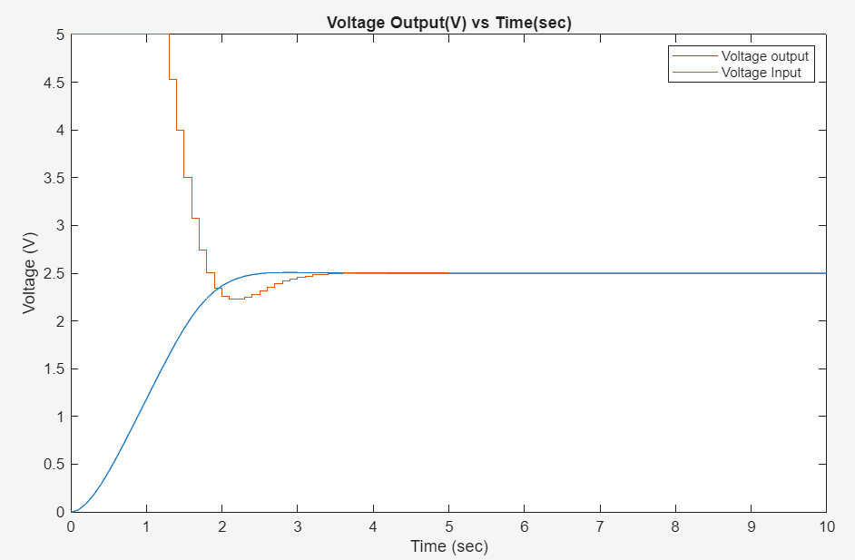
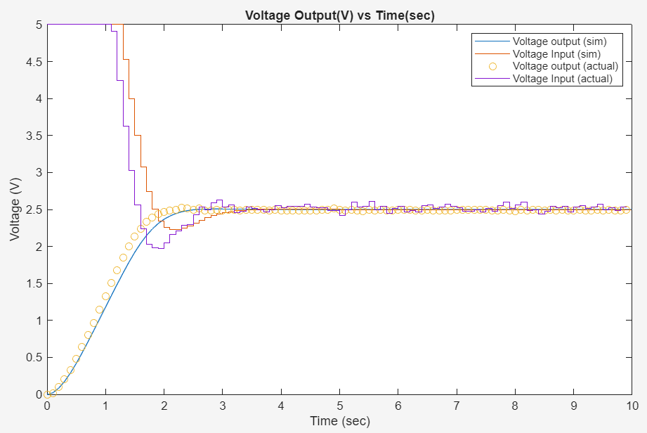

## Overview

The goal of this project was to make an overdamped, second-order RC circuit track a **2.5 V step** as well as possible using a microcontroller as the controller. The controller had to meet these requirements:

| Requirement | Target |
|---|---|
| Peak overshoot | < 1 % |
| Steady-state error | 0 |
| 1 % settling time | < 4 s, using as little control effort as possible |
| Sample rate | 10 Hz |
| Control input | Saturates between 0 V and 5 V (PWM) |

I modeled the plant, verified the model against hardware, then designed and tested two digital controllers. The first was a classical **PI compensator** designed from the frequency response. The second was an **observer-based LQR state-feedback controller**. Both were simulated in Simulink and then run on an Arduino Uno driving an LMC6484 op-amp circuit.

**Result:** the PI controller could not hit < 1 % overshoot and < 4 s settling at the same time. The observer-based controller settled in **~2 s with < 1 % overshoot** on real hardware, using less control effort than the PI design.

*Developed for Harvey Mudd's Advanced Systems Engineering course (E102).*

## The plant

{width=70%}

### Transfer function

Because the op-amp is a voltage follower, $x_1 = V_{out}$. Current balance through the $4R$ resistor and the grounded capacitor gives

$$
\frac{x_2 - V_{out}}{4R} = C s\, V_{out} \;\Rightarrow\; x_2 = V_{out}(1 + 4RCs).
$$

Summing currents at node $x_2$ (the second capacitor is tied to the output):

$$
\frac{x_2 - V_{in}}{R} + \frac{x_2 - V_{out}}{4R} + Cs\,(x_2 - V_{out}) = 0
\;\Rightarrow\; (1 + RCs)(1 + 4RCs)\,V_{out} = V_{in}
$$

$$
H(s) = \frac{1}{4R^2C^2 s^2 + 5RCs + 1} = \frac{1}{s^2 + 2.5s + 1} \qquad (RC = 0.5\text{ s})
$$

The plant has two real poles, at $s = -0.5$ and $s = -2$, so it is overdamped.

### State-space model

Using the capacitor voltages $\mathbf{x} = [x_1,\ x_2]^T$ as states:

$$
\dot{\mathbf{x}} =
\begin{bmatrix} -\frac{1}{4RC} & \frac{1}{4RC} \\ 0 & -\frac{1}{RC} \end{bmatrix}\mathbf{x}
+ \begin{bmatrix} 0 \\ \frac{1}{RC} \end{bmatrix} u,
\qquad
y = \begin{bmatrix} 1 & 0 \end{bmatrix}\mathbf{x}
$$

With $RC = 0.5$ s:

$$
\mathbf{A} = \begin{bmatrix} -0.5 & 0.5 \\ 0 & -2 \end{bmatrix},\quad
\mathbf{B} = \begin{bmatrix} 0 \\ 2 \end{bmatrix},\quad
\mathbf{C} = \begin{bmatrix} 1 & 0 \end{bmatrix},\quad
D = 0
$$

### Open-loop validation

A partial-fraction expansion of the step response gives

$$
y_{step}(t) = \left(1 - \tfrac{4}{3}e^{-t/4RC} + \tfrac{1}{3}e^{-t/RC}\right)u(t).
$$

I applied a 2.5 V step with the Arduino and logged the output over serial. The measured response follows the model closely during the rise. After about 3 s the real circuit is slightly faster than the model, which matters later in the closed-loop results.



## Controller 1: Digital PI compensator

### Frequency-domain design

The PI compensator $C(s) = K_p + K_i/s$ was designed for a **70° phase margin** at a **crossover of 1 rad/s**. At $\omega = 1$ the plant reduces to $H(j) = \frac{1}{2.5j}$, so the loop gain is

$$
G(j) = \frac{K_p - jK_i}{2.5j}.
$$

A 70° phase margin requires $\tan^{-1}(K_i/K_p) = 20°$, so $K_i = 0.364K_p$. Setting $|G(j)| = 1$ then gives

$$
K_p = 2.349, \qquad K_i = 0.855.
$$

### Discretization

Using the backward-difference mapping $s = \frac{1 - z^{-1}}{T}$ with $T = 0.1$ s:

$$
C(z) = K_p + \frac{TK_i}{1 - z^{-1}}
\;\Rightarrow\;
u[n] = u[n-1] + (K_p + TK_i)\,e[n] - K_p\,e[n-1]
$$

This difference equation is cheap enough to run on the Arduino every sample.



### Simulation vs. hardware





The hardware tracks the simulation well. The real system reaches its peak slightly earlier, which matches the open-loop observation that the physical circuit is a bit faster than the model.

### Tuning trials

I swept the phase margin and crossover frequency to see whether any PI design could meet every requirement. $U = \sum |u[n] - u_{ss}|$ measures total control effort.

| $\phi_m$ | $\omega_{co}$ (rad/s) | $t_{settling}$ | $M_p$ | $e_{ss}$ (at 10 s) | $U$ |
|---|---|---|---|---|---|
| 65° | 1.0 | 4.7 s | 9.01 % | 0.0025 | 47.57 |
| 70° | 1.0 | 6.6 s | 2.93 % | 0.0081 | 43.30 |
| 75° | 1.0 | > 10 s | none | 0.0454 | 42.83 |
| 70° | 0.8 | 5.3 s | 13.10 % | 0.0033 | 51.50 |
| 70° | 1.2 | > 10 s | none | 0.1344 | 48.28 |

The tradeoff is clear. Designs fast enough to settle quickly overshoot too much. Designs damped enough to avoid overshoot creep toward the setpoint and do not settle within 10 s. Because the input saturates at 5 V for the first second, the controller cannot simply push harder to rise faster. This motivated a state-space approach.

## Controller 2: Observer-based LQR state feedback

### Discrete plant

MATLAB's `c2d` gives the zero-order-hold equivalent of the plant at $T = 0.1$ s:

$$
\mathbf{A_d} = \begin{bmatrix} 0.9512 & 0.0442 \\ 0 & 0.8187 \end{bmatrix},\quad
\mathbf{B_d} = \begin{bmatrix} 0.0046 \\ 0.1813 \end{bmatrix},\quad
\mathbf{C_d} = \begin{bmatrix} 1 & 0 \end{bmatrix},\quad D_d = 0
$$

### LQR gain and reference scaling

The feedback gain minimizes

$$
J = \frac{1}{2}\sum_{n=0}^{\infty}\left(Q_{11}x_1[n]^2 + Q_{22}x_2[n]^2 + u[n]^2\right)
$$

using `dlqr`. A large $Q_{11}$ penalizes output error heavily. $Q_{22}$ limits how hard the internal capacitor voltage is driven. With $Q_{11} = 100,\ Q_{22} = 1$:

- $\mathbf{K} = \begin{bmatrix} 6.5014 & 1.2697 \end{bmatrix}$
- Closed-loop poles: $z = 0.7549 \pm 0.1322j$
- Reference gain for zero steady-state error: $K_r = \left[\mathbf{C_d}(\mathbf{I} - \mathbf{A_d} + \mathbf{B_d K})^{-1}\mathbf{B_d}\right]^{-1} = 8.7711$

### Observer

Only $x_1$ (the output) is measured, so a Luenberger observer estimates the full state. Its poles were placed at **twice the speed** of the closed-loop poles. In discrete time that means squaring them:

- $\mathbf{L} = \begin{bmatrix} 0.6651 \\ 2.5080 \end{bmatrix}$
- Observer poles: $z = 0.5524 \pm 0.1996j$



![Observer subsystem: $\hat{x}[n+1] = \mathbf{A_d}\hat{x}[n] + \mathbf{B_d}u[n] + \mathbf{L}(y[n] - \mathbf{C_d}\hat{x}[n])$](images/observer-subsystem.png)

### Simulation vs. hardware





### Tuning trials

| $Q_{11}$ | $Q_{22}$ | $t_{settling}$ | $M_p$ | $e_{ss}$ (at 10 s) | $U$ |
|---|---|---|---|---|---|
| **100** | **1** | **2.3 s** | **0.33 %** | 3.1e-11 | **39.98** |
| 100 | 2 | 2.4 s | 0.08 % | 1.3e-11 | 38.35 |
| 100 | 0.5 | 2.2 s | 0.55 % | 2.1e-10 | 40.87 |
| 120 | 1 | 2.2 s | 0.38 % | 4.4e-11 | 40.73 |
| 80 | 1 | 2.4 s | 0.26 % | 1.9e-10 | 39.06 |
| 120 | 0.5 | 2.2 s | 0.60 % | 4.7e-11 | 41.62 |
| 150 | 0.2 | 2.1 s | 0.77 % | 5.5e-11 | 42.91 |
| 280 | 0.07 | 2.0 s | 0.83 % | 2.1e-12 | 45.04 |

Every LQR design met the requirements, and the weights gave smooth, predictable control over the tradeoff. Raising $Q_{11}$ or lowering $Q_{22}$ settles faster but overshoots more and uses more control effort. This made the state-space design much easier to tune than the PI compensator.

### Final design: $Q_{11} = 100,\ Q_{22} = 1$

| | $t_{settling}$ | $M_p$ | $e_{ss}$ | $U$ |
|---|---|---|---|---|
| Simulation | 2.3 s | 0.33 % | ≈ 0 | 39.98 |
| Hardware | 2.0 s | 0.8 % | 0 – 0.01 V | 39.31 |

I chose these weights on purpose instead of the most aggressive design in the table. The hardware is less damped than the model: it settles faster but overshoots more than simulated. A design that only *barely* meets 1 % overshoot in simulation would likely violate it on the real circuit. The default weights leave margin for that model error and still settle in about half the allowed time. The small steady-state error on hardware comes from ADC quantization and noise (one 10-bit count ≈ 4.9 mV), and it stays well within 1 %.

## Firmware

The controller runs on an Arduino Uno. It reads the output on `A0`, computes the control law, and writes the input as PWM.

### Timer-interrupt sampling

A simple `delay(100)` loop does not actually sample at 10 Hz, because reading the ADC, doing the math, and printing over serial all add time to every iteration. Timestamped serial logs showed that 70 samples took 7.109 s instead of 7.000 s. The effective sample period was therefore 0.1016 s instead of 0.1 s. That error is only about 1.5 %, but the controller gains assume an exact $T$.

The firmware below takes the timing from a hardware timer. Timer2 in CTC mode interrupts every 1 ms, and every 100th tick sets a flag that runs one control step in `loop()`. The sample period therefore stays fixed no matter how long the loop body takes. Timer2 was chosen because Timer1 generates the PWM on pin 9.

```{.cpp filename="observer_controller.ino"}
#include <avr/io.h>
#include <avr/interrupt.h>

// PIN SETTINGS
const int yPin = A0;       // analog read pin
const int uPin = 9;        // analog write pin (PWM)
const int switchPin = 3;   // run/stop switch, active low

// CONTROLLER (dlqr with Q11 = 100, Q22 = 1)
const float Kr = 8.7711;
const float K1 = 6.5014;
const float K2 = 1.2697;
const float ref = 2.5;     // 2.5 V reference

// DISCRETE PLANT (c2d, T = 0.1 s) AND OBSERVER GAIN
const float aA1 = 0.9512, aA2 = 0.0442;
const float aA3 = 0,      aA4 = 0.8187;
const float aB1 = 0.0046, aB2 = 0.1813;
const float L1 = 0.6651,  L2 = 2.508;

// Internal signals
float y = 0;
float u = 0;
float xhat1 = 0, xhat2 = 0;
int time = 0;

volatile bool sampleReady = false;

void setup() {
  pinMode(switchPin, INPUT_PULLUP);
  Serial.begin(9600);

  cli();                                // disable interrupts during setup
  TCCR2A = 0;
  TCCR2B = 0;
  TCNT2 = 0;
  TCCR2A |= (1 << WGM21);               // CTC mode
  OCR2A = 124;                          // 16 MHz / (128 * 1 kHz) - 1
  TCCR2B |= (1 << CS22) | (1 << CS20);  // prescaler 128
  TIMSK2 |= (1 << OCIE2A);              // enable compare-match interrupt
  sei();
}

ISR(TIMER2_COMPA_vect) {
  static uint8_t ticks = 0;
  if (++ticks >= 100) {    // 100 x 1 ms = 100 ms
    ticks = 0;
    sampleReady = true;
  }
}

void loop() {
  if (!sampleReady) return;
  sampleReady = false;

  // Hold the input at 0 V until the switch is turned on
  if (digitalRead(switchPin) == HIGH) {
    analogWrite(uPin, 0);
    return;
  }

  // READ CIRCUIT OUTPUT
  y = analogRead(yPin) * (5.0 / 1023.0);

  // CONTROLLER
  u = ref * Kr - xhat1 * K1 - xhat2 * K2;

  // OBSERVER
  float newxhat1 = (xhat1 * aA1 + xhat2 * aA2) + aB1 * u + L1 * (y - xhat1);
  float newxhat2 = (xhat1 * aA3 + xhat2 * aA4) + aB2 * u + L2 * (y - xhat1);
  xhat1 = newxhat1;
  xhat2 = newxhat2;

  // Saturate to the 0-5 V range of the PWM output
  u = constrain(u, 0, 5);

  // WRITE CIRCUIT INPUT
  analogWrite(uPin, u * (255 / 5));

  Serial.print(time++);
  Serial.print(" ");
  Serial.print(y);
  Serial.print(" ");
  Serial.println(u);
}
```

The PI controller uses the same sampling scaffold. Only the control step changes:

```{.cpp filename="pi_controller.ino (control step)"}
const float Kp = 2.349;
const float Ki = 0.855;
const float T  = 0.1;
float e = 0;               // previous error

// inside loop(), after reading y:
u = u + (Kp + Ki * T * 2) * (ref - y) - Kp * e;
e = ref - y;
u = constrain(u, 0, 5);    // storing the clamped u also prevents integrator windup
```

::: {.callout-note collapse="true"}
## MATLAB design script (observer-based controller)

```matlab
T = 0.1;  R = 50000;  C = 0.00001;

% Continuous plant
Aa = [-1/(4*R*C), 1/(4*R*C);
       0,        -1/(R*C)];
Ba = [0; 1/(R*C)];
Ca = [1, 0];
Da = 0;

% Discretize with a zero-order hold
sysd = c2d(ss(Aa, Ba, Ca, Da), T);
Ad = sysd.A;  Bd = sysd.B;  Cd = sysd.C;  Dd = sysd.D;

% LQR state feedback
Q  = [100 0; 0 1]/2;
Rq = 1/2;
[K, ~, p] = dlqr(Ad, Bd, Q, Rq);

% Reference gain for zero steady-state error
Kr = inv((Cd - Dd*K) * inv(eye(2) - Ad + Bd*K) * Bd);

% Observer twice as fast as the closed loop (squared discrete poles)
L = place(Ad', Cd', p.^2)';

% Simulate and compute performance metrics
sim('Simulink_digital_controller_observer.slx', 10);
Yout = yout{1}.Values.Data;
Uout = yout{2}.Values.Data;
stepval = 2.5;
within = abs(Yout - stepval) < 0.01*stepval;
tsettling = tout(find(~within, 1, 'last'));
Mp  = 100*(max(Yout)/stepval - 1);
ess = abs(Yout(end) - stepval);
U   = sum(abs(Uout - 2.5));
```
:::

## Sources of model error

- **Sampling period drift.** With the delay-based loop, the real sample period was about 1.5 % longer than the $T$ the gains were designed for. Timer-interrupt sampling removes this error.
- **Component non-idealities.** The model assumes ideal, linear resistors and capacitors and an ideal op-amp. Component tolerances (capacitors are commonly ±10–20 %), capacitor leakage, and op-amp offset all shift the real time constants. That explains why the hardware responds faster than the model and settles slightly below 2.5 V in open loop.
- **System identification.** Fitting a two-exponential model directly to the measured open-loop step response matched the hardware better than the nominal $R$ and $C$ values. Designing the controller from an identified model (for example, with MATLAB's `tfest`) would close most of the remaining gap between simulation and hardware.

## Takeaways

- Modeling the plant first and checking it against open-loop data made it possible to predict closed-loop behavior before running any code on hardware.
- A single-loop PI compensator with a saturated actuator could not meet tight overshoot and settling requirements at the same time. The LQR design met all of them with less control effort.
- When the plant model is imperfect, it pays to choose a design that meets requirements with margin rather than the most aggressive design that passes in simulation.
