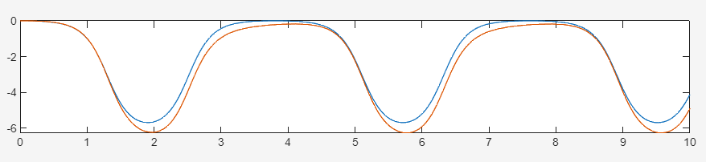
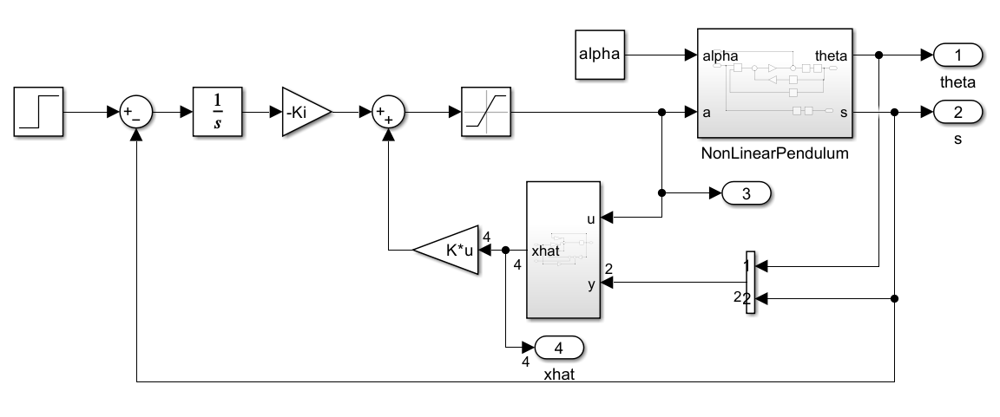
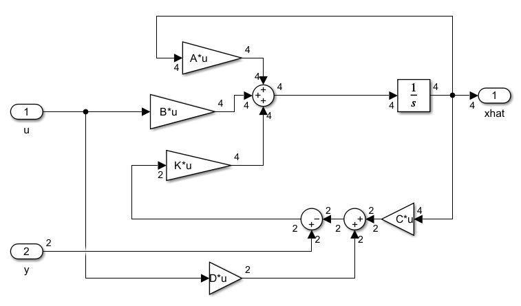
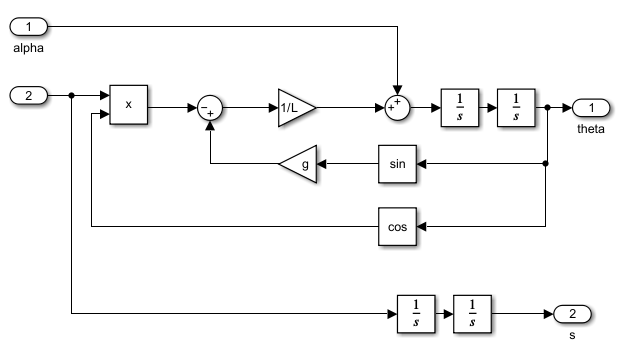
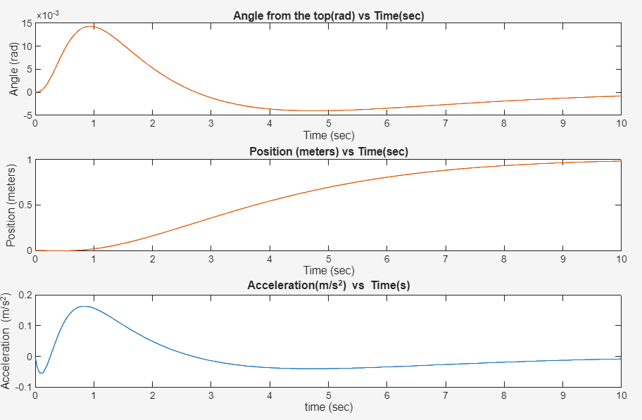
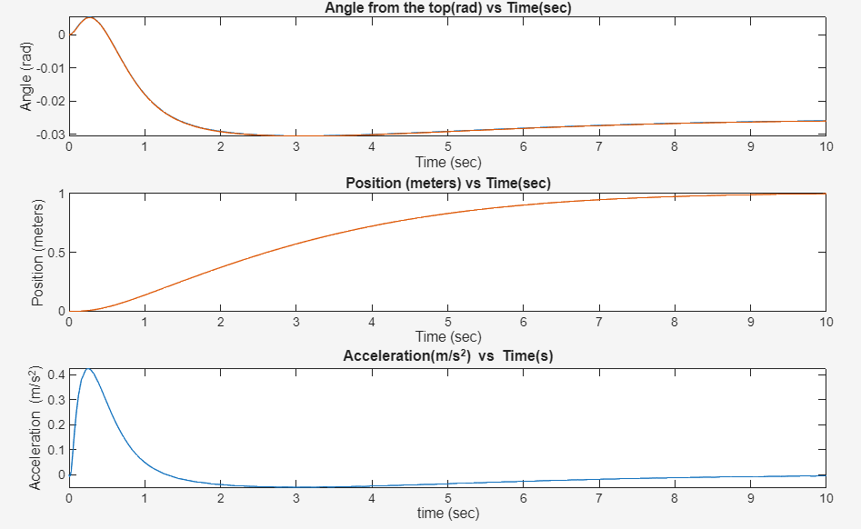
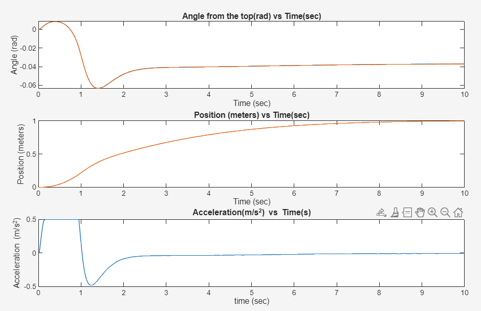
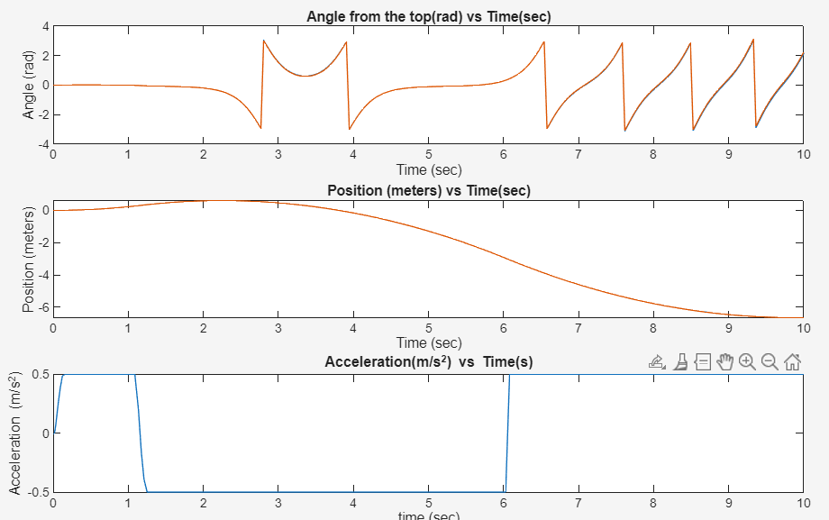
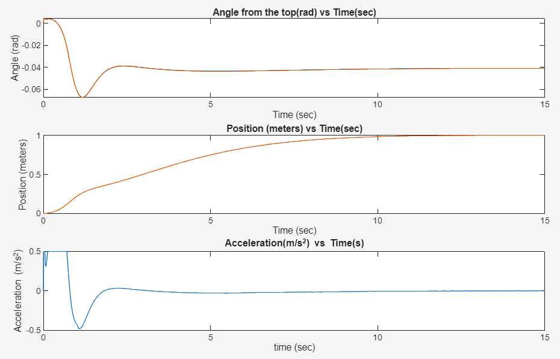

## Overview

The goal of this project was to balance an inverted pendulum on a cart while **moving the cart 1 m in 10 s without overshooting**. A constant disturbance torque pushes on the pendulum the whole time, and the cart's acceleration is limited to **±0.5 m/s²**.

I linearized the dynamics, designed a state-feedback controller with integral action and a Luenberger observer, and then tested the linear controller in Simulink against the **full nonlinear** pendulum model. The final controller handles disturbances up to $\alpha \approx 0.72$ rad/s² before the acceleration limit makes it lose the pendulum.

*Developed for Harvey Mudd's Advanced Systems Engineering course (E102).*

## Dynamics

With $\theta$ measured from vertical, $s$ the cart position, $a$ the cart acceleration (the control input), and $\alpha$ a disturbance acting on the pendulum:

$$
L\ddot{\theta} - g\sin\theta = -a\cos\theta + L\alpha, \qquad \ddot{s} = a
$$

### Linearization and state-space model

For small angles, $\sin\theta \approx \theta$ and $\cos\theta \approx 1$. With state $\mathbf{x} = [\theta,\ \dot\theta,\ s,\ \dot s]^T$, input $u = a$, and disturbance $w = \alpha$:

$$
\dot{\mathbf{x}} =
\begin{bmatrix} 0 & 1 & 0 & 0 \\ \frac{g}{L} & 0 & 0 & 0 \\ 0 & 0 & 0 & 1 \\ 0 & 0 & 0 & 0 \end{bmatrix}\mathbf{x}
+ \begin{bmatrix} 0 \\ -\frac{1}{L} \\ 0 \\ 1 \end{bmatrix} u
+ \begin{bmatrix} 0 \\ 1 \\ 0 \\ 0 \end{bmatrix} w,
\qquad
\mathbf{y} = \begin{bmatrix} 1 & 0 & 0 & 0 \\ 0 & 0 & 1 & 0 \end{bmatrix}\mathbf{x}
$$

Both the angle and the cart position are measured, and $\mathbf{D} = \mathbf{0}$. With $L = 0.5$ m and $g = 9.81$ m/s²:

$$
\mathbf{A} = \begin{bmatrix} 0 & 1 & 0 & 0 \\ 19.62 & 0 & 0 & 0 \\ 0 & 0 & 0 & 1 \\ 0 & 0 & 0 & 0 \end{bmatrix},\quad
\mathbf{B} = \begin{bmatrix} 0 \\ -2 \\ 0 \\ 1 \end{bmatrix},\quad
\mathbf{C} = \begin{bmatrix} 1 & 0 & 0 & 0 \\ 0 & 0 & 1 & 0 \end{bmatrix},\quad
\mathbf{D} = \begin{bmatrix} 0 \\ 0 \end{bmatrix}
$$


- **Open-loop poles:** $\pm 4.43,\ 0,\ 0$. The pole at $+4.43$ makes the upright pendulum unstable.
- **Controllability and observability matrices** both have rank 4, so every state can be controlled and estimated.

## Controller design

### Integral action

A constant disturbance would leave a steady-state position error under plain state feedback. To remove it, I augmented the state with the integral of the position error. This gives five gains: four on the state and one on the integrator.

$$
\mathbf{A_a} = \begin{bmatrix} \mathbf{A} & \mathbf{0} \\ -\mathbf{C}_s & 0 \end{bmatrix}, \qquad
\mathbf{B_a} = \begin{bmatrix} \mathbf{B} \\ 0 \end{bmatrix}
$$

### Pole placement

The cart must reach 1 m in 10 s with no overshoot. I placed a dominant pole pair from a second-order response with a 1 % settling time of 10 s:

$$
\omega_n = \frac{4.6}{10\,\zeta}, \qquad s = -\zeta\omega_n \pm \omega_n\sqrt{1-\zeta^2}\,j
$$

The other three poles sit about 10× further left (at $-10\zeta\omega_n$, $-10.1\zeta\omega_n$, $-10.2\zeta\omega_n$) so they do not affect the dominant response.

My first instinct was critical damping. Testing showed that **$\zeta = 0.9$** ($\omega_n = 0.511$ rad/s) reaches the target noticeably faster and still does not overshoot. `place` then gives:

$$
\mathbf{K} = \begin{bmatrix} -51.51 & -11.63 & -5.56 & -8.40 \end{bmatrix}, \qquad K_i = 1.335
$$

### Observer

The observer estimates the full state from the measured $\theta$ and $s$. Its poles were placed at $-73$ to $-76$, far faster than the controller, so the estimate converges almost immediately. Slower observer poles (around $-20$) visibly lagged the true state, and the controller then acted on stale information:



Very fast observer poles work here because the simulated sensors are noise-free. On real hardware, fast observer poles amplify measurement noise, so they would need to be slower and tuned as a tradeoff.

## Simulink model





The plant block uses the full nonlinear equations with $\sin\theta$ and $\cos\theta$ rather than the linearized model, so the simulation tests how well the linear design holds up on the real dynamics:

{width=75%}

## Disturbance rejection

I increased the constant disturbance $\alpha$ until the controller failed. Each plot shows the angle, cart position, and commanded acceleration.

::: {layout-ncol=2}







:::

The stability boundary lies between $\alpha = 0.72$ and $0.73$ rad/s².

### Why it fails

A constant disturbance moves the pendulum's equilibrium off vertical, to the angle where $g\sin\theta = -L\alpha$. For $\alpha = 0.5$ this predicts $\theta = -0.0255$ rad, which matches where the simulated pendulum settles.

The pendulum starts at $\theta = 0$ rather than at this new equilibrium, so the controller has to swing it over first. As $\alpha$ grows, that correction needs more acceleration than the ±0.5 m/s² limit allows. Every failure follows the same pattern: the commanded acceleration saturates at −0.5 m/s², and the controller cannot recover.

### Tuning for a larger disturbance (and why I didn't use it)



A specially tuned version survived $\alpha = 0.8$. It started from a pre-tilted initial state, delayed the position step by 1 s so the pendulum could settle first, and added a small non-zero feedthrough term. However, each of these changes relies on knowing the disturbance's exact size and direction in advance. If $\alpha$ changed sign or varied over time, this version would likely perform *worse* than the general design, so I kept the general design.

::: {.callout-note collapse="true"}
## MATLAB design script

```matlab
g = 9.81;          % gravity (m/s^2)
L = 0.5;           % pendulum length (m)
alpha = 0.5;       % disturbance
maxaccel = 0.5;    % actuator limit (m/s^2)

A = [0,   1, 0, 0;
     g/L, 0, 0, 0;
     0,   0, 0, 1;
     0,   0, 0, 0];
B = [0; -1/L; 0; 1];
C = [1, 0, 0, 0;
     0, 0, 1, 0];
D = [0; 0];

poles         = eig(A);              % open-loop stability
Control       = rank(ctrb(A, B));    % controllability
Observability = rank(obsv(A, C));    % observability

% Augment with the integral of position error
Aa = [A, zeros(4,1);
      -C(2,:), 0];
Ba = [B; 0];

zeta = 0.9;                % fastest damping ratio with no overshoot
wn   = 4.6/(10*zeta);      % 1% settling in 10 s
ControlPoles = [-zeta*wn + wn*sqrt(1-zeta^2)*1j, ...
                -zeta*wn - wn*sqrt(1-zeta^2)*1j, ...
                -10*zeta*wn, -10.1*zeta*wn, -10.2*zeta*wn];
Ka = place(Aa, Ba, ControlPoles);
K  = Ka(1:4);
Ki = Ka(5);

% Fast observer: the simulated sensors are noise-free
ObserverL = place(A', C', [-73, -74, -75, -76])';

sim('Simulink_inverted_pendulum.slx', 10);
```
:::

## Takeaways

- A controller designed on a linearized model can work well on the nonlinear plant, as long as it keeps the system near the operating point where the linearization is valid.
- Actuator limits, not linear stability, set the real performance boundary. Every failure began when acceleration saturated.
- Observer speed is a tradeoff. In a noise-free simulation, faster is better. With real sensors, the observer poles would also need to filter noise.
- Tuning a controller for one exact scenario can make it look better while making it less robust. A natural next step would be to use pole placement as a starting point and then refine the gains with an optimizer (for example, `fminsearch`) against a cost that includes robustness across a range of disturbances.
