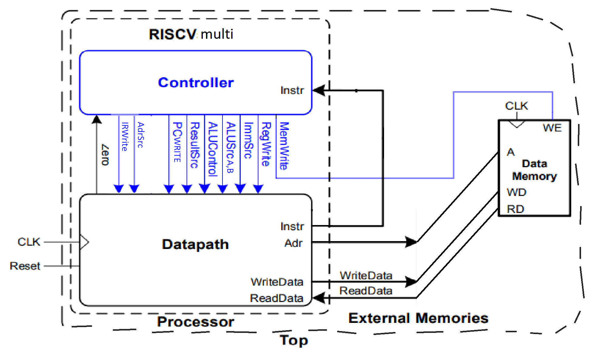
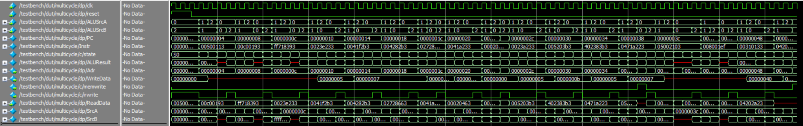
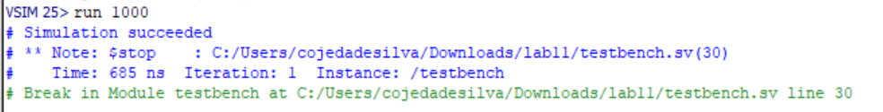

## Overview

A single-cycle processor finishes every instruction in one long clock cycle. That forces it to have separate instruction and data memories and extra adders, because everything an instruction needs has to happen at the same time.

In this project I extended a single-cycle RISC-V processor to work as a **multicycle** processor, which splits each instruction into shorter steps. Because the steps happen in different cycles, the hardware can be shared:

- **One memory** holds both instructions and data.
- **One ALU** computes PC + 4, branch targets, memory addresses, and arithmetic results.
- **Registers** between the steps hold values from one cycle to the next.
- **A finite state machine** replaces the single-cycle decoder and sequences each instruction.

The processor implements a subset of RV32I: `lw`, `sw`, `add`, `sub`, `and`, `or`, `slt`, `addi`, `andi`, `ori`, `slti`, `beq`, and `jal`. It ran the full test program correctly in simulation, finishing with the expected value of 71 written to address 84.

*Developed for Harvey Mudd's Digital Electronics and Computer Engineering course (E85). The starting single-cycle code, the testbench, and the test program come from Harris & Harris, Digital Design and Computer Architecture: RISC-V Edition. I wrote the multicycle datapath changes and the controller FSM.*

## From single-cycle to multicycle

The processor keeps the textbook's split between a datapath and a controller. The biggest visible change is that the controller now needs a clock and reset, because it has state. It also drives a new set of enables and selects, and only one address now goes to memory.

{width=75%}

| Change | Why it is needed |
|---|---|
| Combined instruction and data memory (`dimem`) | The address now comes from a mux (`AdrSrc`), which picks the PC during fetch and the ALU's result during a load or store. |
| `Instr` register with enable `IRWrite` | The memory output changes when the address changes, so the instruction has to be saved for the rest of its steps. |
| `OldPC` register | The PC is updated during fetch, but branches and jumps are relative to the original instruction's address. |
| `Data` register | Holds the value read from memory for the following cycle, when it is written to the register file. |
| `A` and `WriteData` registers | Hold the two register file outputs between decode and execute. |
| `ALUOut` register | Holds the ALU's result for the next cycle, so the ALU is free to do something else. |
| `mux3` on both ALU inputs (`ALUSrcA`, `ALUSrcB`) | The single ALU now takes the PC, `OldPC`, or `A` on one side and `WriteData`, the immediate, or the constant 4 on the other. |
| FSM controller | Control signals now depend on the current step, not only on the instruction. |

The top level shows the shared memory: there is a single `DataAdr` for both instruction fetches and data accesses.

```{.systemverilog filename="top.sv"}
module top(input  logic        clk, reset,
           output logic [31:0] WriteData, DataAdr,
           output logic        MemWrite);

  logic [31:0] Instr, ReadData;
  // instantiate processor and memories
  multicycle multicycle(clk, reset, DataAdr, MemWrite,
                        WriteData, ReadData);
  dimem dimem(clk, MemWrite, DataAdr, WriteData, ReadData);
endmodule

module dimem(input  logic        clk, WE,
             input  logic [31:0] A, WD,
             output logic [31:0] RD);
  logic [31:0] RAM[63:0];

  assign RD = RAM[A[31:2]]; // word aligned
  initial $readmemh("memfile.dat", RAM);
  always_ff @(posedge clk)
    if (WE) RAM[A[31:2]] <= WD;
endmodule
```

## Datapath

The datapath is where the sharing happens. There is no separate adder for the next PC or for branch targets. Instead, every path into or out of the ALU goes through a mux, and the controller chooses the path for each cycle.

The `Result` bus is the key signal. It drives the PC, the memory address mux, and the register file's write port, so a single 3-input mux (`ResultSrc`) picks between the saved `ALUOut`, the saved memory `Data`, and the live `ALUResult`.

```{.systemverilog filename="datapath"}
module datapath(input  logic        clk, reset,
                input  logic [1:0]  ResultSrc, ALUSrcA, ALUSrcB,
                input  logic        AdrSrc, IRWrite, PCWrite,
                input  logic        RegWrite,
                input  logic [1:0]  ImmSrc,
                input  logic [2:0]  ALUControl,
                output logic        Zero,
                output logic [31:0] Adr,
                output logic [31:0] Instr, //now output
                output logic [31:0] WriteData, //no ALUResult
                input  logic [31:0] ReadData);

  logic [31:0] PC, ALUResult, ALUOut, Data, OldPC;
  logic [31:0] ImmExt, A, Out1, Out2;
  logic [31:0] SrcA, SrcB;
  logic [31:0] Result;
  // next PC logic
  flopre #(32) pcreg(clk, reset, Result, PCWrite, PC);
  mux2 #(32)  adrmux(PC, Result, AdrSrc, Adr);
  flopre #(32) insreg(clk, reset, ReadData, IRWrite, Instr);
  flopre #(32) opcreg(clk, reset, PC, IRWrite, OldPC);
  flopr #(32) datareg(clk, reset, ReadData, Data);
  // register file logic
  RegFile     RF(clk, RegWrite, Instr[19:15], Instr[24:20],
                 Instr[11:7], Result, Out1, Out2);
  Extend      Ext(Instr[31:7], ImmSrc, ImmExt);
  flopr #(32) Areg(clk, reset, Out1, A);
  flopr #(32) Breg(clk, reset, Out2, WriteData);
  // ALU logic
  mux3 #(32)  SrcAmux(PC, OldPC, A, ALUSrcA, SrcA);
  mux3 #(32)  SrcBmux(WriteData, ImmExt, 32'b00000000000000000000000000000100, ALUSrcB, SrcB);
  alu         ALU(SrcA, SrcB, ALUControl, ALUResult, Zero);
  flopr #(32) Resreg(clk, reset, ALUResult, ALUOut);
  mux3 #(32)  Resultmux(ALUOut, Data, ALUResult, ResultSrc, Result);
endmodule
```

## Controller

The controller replaces the single-cycle decoder with an 11-state FSM. Every instruction shares the first two states, then branches on its opcode.

```{mermaid}
%%| fig-cap: "Controller state transitions. Unrecognized opcodes return from S1 to S0."
flowchart TD
  S0["S0 Fetch"] --> S1["S1 Decode"]
  S1 -- "lw, sw" --> S2["S2 MemAdr"]
  S1 -- "R-type" --> S6["S6 ExecuteR"]
  S1 -- "I-type ALU" --> S8["S8 ExecuteI"]
  S1 -- "jal" --> S9["S9 JAL"]
  S1 -- "beq" --> S10["S10 BEQ"]
  S2 -- "lw" --> S3["S3 MemRead"]
  S2 -- "sw" --> S5["S5 MemWrite"]
  S3 --> S4["S4 MemWB"]
  S6 --> S7["S7 ALUWB"]
  S8 --> S7
  S9 --> S7
  S4 --> S0
  S5 --> S0
  S7 --> S0
  S10 --> S0
```

| State | Name | What happens |
|--|---|----------------|
| S0 | Fetch | Reads the instruction at `PC` into `Instr`, saves `OldPC`, and updates `PC` to PC + 4. |
| S1 | Decode | Reads the registers and computes `OldPC` + immediate, which is the target for `beq` and `jal`. |
| S2 | MemAdr | Computes `A` + immediate, the load or store address. |
| S3 | MemRead | Sends `ALUOut` to memory as the address. |
| S4 | MemWB | Writes `Data` to the register file. |
| S5 | MemWrite | Sends `ALUOut` to memory as the address and writes `WriteData`. |
| S6 | ExecuteR | Runs the ALU on `A` and `WriteData`. |
| S7 | ALUWB | Writes `ALUOut` to the register file. |
| S8 | ExecuteI | Runs the ALU on `A` and the immediate. |
| S9 | JAL | Loads the target from `ALUOut` into `PC`, and computes `OldPC` + 4 for the link register. |
| S10 | BEQ | Subtracts `A` and `WriteData`. If `Zero` is set, loads the target from `ALUOut` into `PC`. |

The number of cycles depends on the instruction: 3 for `beq`, 4 for `sw`, `jal`, and the R-type and I-type ALU instructions, and 5 for `lw`.

`S0` is the clearest example of how the shared hardware works. The ALU adds 4 to the PC, and that result goes straight through `ResultSrc` to the PC register without waiting for `ALUOut`. On the same clock edge, the instruction is captured.

`jal` is the most interesting path because it needs two separate values from one ALU. `S1` already put the jump target in `ALUOut`, so `S9` loads the PC from there while the ALU computes the return address. `S7` then writes that return address to `rd`, reusing the same write-back state as the arithmetic instructions.

PC updates come from two sources: unconditional updates in `S0` and `S9`, and conditional updates in `S10` that depend on the ALU's `Zero` flag.

```{.systemverilog filename="controller (excerpt)"}
assign pcwrite = ((branch && zero) || PCUpdate);

case (state)
  S0: begin                      // Fetch: PC <- PC + 4
    nextstate = S1;
    irwrite = 1'b1;
    alusrca = 2'b00;
    alusrcb = 2'b10;
    ALUOp = 2'b00;
    resultsrc = 2'b10;
    PCUpdate = 1'b1;
  end
  S1: begin                      // Decode: ALUOut <- OldPC + imm
    alusrca = 2'b01;
    alusrcb = 2'b01;
    ALUOp = 2'b00;
    case (op)
      7'b0000011: nextstate = S2;
      7'b0100011: nextstate = S2;
      7'b0110011: nextstate = S6;
      7'b0010011: nextstate = S8;
      7'b1101111: nextstate = S9;
      7'b1100011: nextstate = S10;
      default: nextstate = S0;
    endcase
  end
```

::: {.callout-note collapse="true"}
## Full controller

```{.systemverilog filename="controller"}
module controller(input logic clk,
  input logic reset,
  input logic [6:0] op,
  input logic [2:0] funct3,
  input logic funct7b5,
  input logic zero,
  output logic [1:0] immsrc,
  output logic [1:0] alusrca, alusrcb,
  output logic [1:0] resultsrc,
  output logic adrsrc,
  output logic [2:0] alucontrol,
  output logic irwrite, pcwrite,
  output logic regwrite, memwrite);
  logic[1:0] ALUOp;
  logic PCUpdate, branch;
  assign pcwrite = ((branch && zero) || PCUpdate);
  typedef enum logic [3:0] {S0, S1, S2, S3, S4, S5, S6, S7, S8, S9, S10} statetype;
  statetype state, nextstate;
  always_ff @(posedge clk, posedge reset) begin
    if (reset) state <= S0;
    else state <= nextstate;
  end
  //Immsrc
  always_comb
    case (op)
      7'b0100011: immsrc = 2'b01;
      7'b1100011: immsrc = 2'b10;
      7'b1101111: immsrc = 2'b11;
      default: immsrc = 2'b00;
    endcase
  //ALUControl
  always_comb
    case(ALUOp)
      2'b00: alucontrol <= 3'b000; // add
      2'b01: alucontrol <= 3'b001; // sub
      default: case({funct7b5 & op[5], funct3}) // R- or I-type
        4'b0000: alucontrol <= 3'b000; // ADD
        4'b1000: alucontrol <= 3'b001; // SUB
        4'b0111: alucontrol <= 3'b010; // AND
        4'b0110: alucontrol <= 3'b011; // OR
        4'b0010: alucontrol <= 3'b101; // SLT
        default: alucontrol <= 3'bxxx; // ???
      endcase
    endcase
  //MainFSM
  always_comb
  begin
    irwrite = 1'b0;
    alusrca = 2'b00;
    alusrcb = 2'b00;
    ALUOp = 2'b00;
    resultsrc = 2'b00;
    adrsrc = 1'b0;
    regwrite = 1'b0;
    memwrite = 1'b0;
    PCUpdate = 1'b0;
    branch = 1'b0;
    case (state)
      S0: begin
        nextstate = S1;
        irwrite = 1'b1;
        alusrca = 2'b00;
        alusrcb = 2'b10;
        ALUOp = 2'b00;
        resultsrc = 2'b10;
        PCUpdate = 1'b1;
      end
      S1: begin
        alusrca = 2'b01;
        alusrcb = 2'b01;
        ALUOp = 2'b00;
        case (op)
          7'b0000011: nextstate = S2;
          7'b0100011: nextstate = S2;
          7'b0110011: nextstate = S6;
          7'b0010011: nextstate = S8;
          7'b1101111: nextstate = S9;
          7'b1100011: nextstate = S10;
          default: nextstate = S0;
        endcase
      end
      S2: begin
        alusrca = 2'b10;
        alusrcb = 2'b01;
        ALUOp = 2'b00;
        if (op == 7'b0000011) nextstate = S3;
        else nextstate = S5;
      end
      S3: begin
        resultsrc = 2'b00;
        adrsrc = 1'b1;
        nextstate = S4;
      end
      S4: begin
        resultsrc = 2'b01;
        regwrite = 1'b1;
        nextstate = S0;
      end
      S5: begin
        resultsrc = 2'b00;
        adrsrc = 1'b1;
        memwrite = 1'b1;
        nextstate = S0;
      end
      S6: begin
        alusrca = 2'b10;
        alusrcb = 2'b00;
        ALUOp = 2'b10;
        nextstate = S7;
      end
      S7: begin
        resultsrc = 2'b00;
        regwrite = 1'b1;
        nextstate = S0;
      end
      S8: begin
        alusrca = 2'b10;
        alusrcb = 2'b01;
        ALUOp = 2'b10;
        nextstate = S7;
      end
      S9: begin
        alusrca = 2'b01;
        alusrcb = 2'b10;
        ALUOp = 2'b00;
        resultsrc = 2'b00;
        PCUpdate = 1'b1;
        nextstate = S7;
      end
      S10: begin
        alusrca = 2'b10;
        alusrcb = 2'b00;
        ALUOp = 2'b01;
        resultsrc = 2'b00;
        branch = 1'b1;
        nextstate = S0;
      end
      default: begin
        nextstate = S0;
        irwrite = 1'b0;
        alusrca = 2'b00;
        alusrcb = 2'b00;
        ALUOp = 2'b00;
        resultsrc = 2'b00;
        adrsrc = 1'b0;
        regwrite = 1'b0;
        memwrite = 1'b0;
        PCUpdate = 1'b0;
        branch = 1'b0;
      end
    endcase
  end
endmodule
```
:::

## Verification

I tested the processor in simulation with Questa, using the textbook's test program. It exercises every instruction type, including one branch that is taken and one that is not. Two `addi` instructions should never run, and if the program goes wrong, the final value changes. The testbench passes only if 71 is written to address 84.

```{.riscv filename="memfile.asm"}
main:   addi x2, x0, 5          # initialize x2 = 5     0    00500113
        addi x3, x0, 12         # initialize x3 = 12    4    00c00193
        addi x7, x3, -9         # initialize x7 = 3     8    ff718393
        or   x4, x7, x2         # x4 = (3 OR 5) = 7     C    0023e233
        and  x5, x3, x4         # x5 = (12 AND 7) = 4   10   0041f2b3
        add  x5, x5, x4         # x5 = 4 + 7 = 11       14   004282b3
        beq  x5, x7, end        # shouldn't be taken    18   02728663
        slt  x4, x3, x4         # x4 = (12 < 7) = 0     1C   0041a233
        beq  x4, x0, around     # should be taken       20   00020463
        addi x5, x0, 0          # shouldn't happen      24   00000293
around: slt  x4, x7, x2         # x4 = (3 < 5) = 1      28   0023a233
        add  x7, x4, x5         # x7 = 1 + 11 = 12      2C   005203b3
        sub  x7, x7, x2         # x7 = 12 - 5 = 7       30   402383b3
        sw   x7, 68(x3)         # [80] = 7              34   0471a223
        lw   x2, 80(x0)         # x2 = [80] = 7         38   05002103
        jal  x3, end            # jump to end, x3 = 64  3C   008001ef
        addi x2, x0, 1          # shouldn't happen      40   00100113
end:    add  x2, x2, x3         # x2 = 7 + 64 = 71      44   00310133
        sw   x2, 84(x0)         # write mem[84] = 71    48   04202a23
```

### Tracing the first three instructions

All three are `addi`, so each one takes the same four states: Fetch, Decode, ExecuteI, and ALUWB. `PC` changes at the end of Fetch, so it already reads the next address during Decode.

| Cycle | State | PC | Instr | Result | Notes |
|---|---|---|---|---|---|
| 1 | S0 | 00 | | 4 | PC + 4 |
| 2 | S1 | 04 | 00500113 | | ALU computes OldPC + immediate |
| 3 | S8 | 04 | | | ALUResult = x0 (0) + 5 = 5 |
| 4 | S7 | 04 | | 5 | Result = ALUOut, written to x2 |
| 5 | S0 | 04 | | 8 | PC + 4 |
| 6 | S1 | 08 | 00c00193 | | ALU computes OldPC + immediate |
| 7 | S8 | 08 | | | ALUResult = x0 (0) + 12 = 12 |
| 8 | S7 | 08 | | 12 | Result = ALUOut, written to x3 |
| 9 | S0 | 08 | | 12 | PC + 4 |
| 10 | S1 | 0c | ff718393 | | ALU computes OldPC + immediate |
| 11 | S8 | 0c | | | ALUResult = x3 (12) + (−9) = 3 |
| 12 | S7 | 0c | | 3 | Result = ALUOut, written to x7 |
| 13 | S0 | 0c | | 16 | PC + 4 |

### Results

The waveform below shows the whole program. `ALUSrcA` and `ALUSrcB` step through their patterns for each instruction type, `IRWrite` pulses once at each fetch, and `Adr` switches away from the PC only for memory accesses.



The simulation stopped at 685 ns on the successful write of 71 to address 84:

{width=75%}

The program ran **17 instructions in 67 clock cycles**, an average of about **3.94 cycles per instruction**. This matches the state counts above: with the 10 ns clock in the testbench, the 67th cycle reaches its falling edge, where the testbench checks the write, at exactly 685 ns.

## Takeaways

- Most of the design is deciding what has to be saved between cycles. Almost every register I added exists because a value would otherwise change or be lost before the next step needs it.
- Reusing hardware moves complexity into control. The datapath is smaller in functional units, but the controller grew from a decoder into an FSM, and each state has to set its muxes correctly.
- Multicycle is not automatically faster. A single-cycle processor would run the same 17 instructions in 17 cycles, so this design only matches it if its clock is about 3.9 times faster. Its clear advantage here is needing less hardware.
