## Overview

A square wave is a sum of sinusoids: a DC offset, a fundamental, and a series of harmonics at integer multiples of the fundamental. Removing every harmonic leaves a clean sine wave at the fundamental frequency:

$$
f(t) = a_0 + a_1\sin(\omega_0 t) + a_2\sin(2\omega_0 t) + a_3\sin(3\omega_0 t) + \dots
\;\xrightarrow{\text{low-pass}}\;
a_0 + a_1\sin(\omega_0 t)
$$

In this project I converted a ~10 Hz, 0–5 V square wave into a sinusoid with two filter stages in series:

1. A **4th-order analog Butterworth low-pass** built from two Sallen-Key op-amp stages.
2. An **8-tap FIR "modified comb" filter**, sampled at 100 Hz and running on an Arduino Uno.

Each filter covers the other's weakness. The analog filter is immune to aliasing but rolls off gradually. The digital filter has a much sharper cutoff but only works on signals that were band-limited before sampling. Together they reduced every harmonic of the square wave to the noise floor of the Arduino's ADC.

*Developed for Harvey Mudd's Systems Engineering course (E101).*

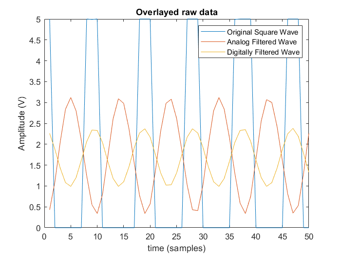{width=70%}

## Filter design

### Analog stage: 4th-order Butterworth

A 4th-order Butterworth low-pass with corner frequency $\omega_c = 2\pi \cdot 10$ rad/s factors into two second-order sections:

$$
H(s) = \frac{1}{\left(\frac{s^2}{\omega_c^2} + 2\cos\!\left(\frac{3\pi}{8}\right)\frac{s}{\omega_c} + 1\right)\left(\frac{s^2}{\omega_c^2} + 2\cos\!\left(\frac{\pi}{8}\right)\frac{s}{\omega_c} + 1\right)}
$$

Each section is a unity-gain Sallen-Key stage, whose transfer function is

$$
H_i(s) = \frac{1}{R_1R_2C_1C_2\,s^2 + (R_1 + R_2)C_2\,s + 1}
$$

With standard component values, the two stages land very close to the ideal Butterworth damping ratios ($\cos(3\pi/8) = 0.383$ and $\cos(\pi/8) = 0.924$):

| Stage | $R_1$ | $R_2$ | $C_1$ | $C_2$ | $f_n$ | $\zeta$ |
|---|---|---|---|---|---|---|
| 1 | 47 kΩ | 270 kΩ | 0.22 µF | 0.1 µF | 9.53 Hz | 0.949 |
| 2 | 27 kΩ | 100 kΩ | 1 µF | 0.1 µF | 9.69 Hz | 0.386 |

::: {layout="[55,45]" layout-valign="center"}
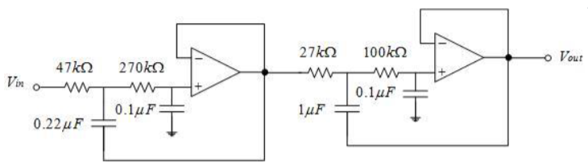

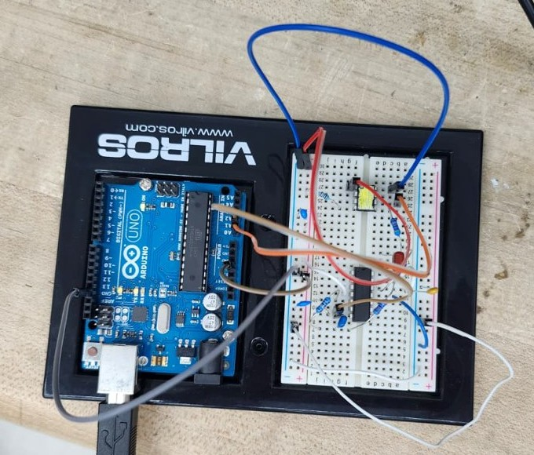
:::

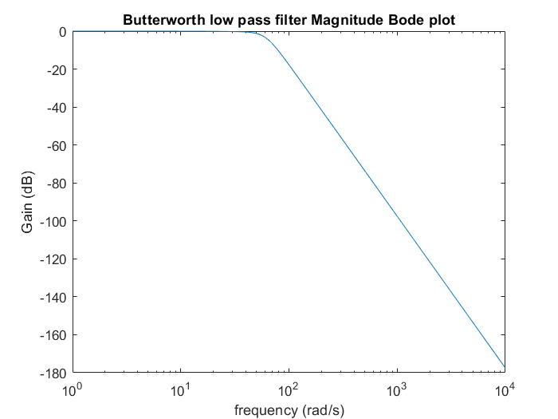{width=70%}

### Digital stage: FIR modified comb filter

The digital filter starts from a comb filter, $1 - z^{-10}$. At $f_s = 100$ Hz, this places zeros at every multiple of 10 Hz. Dividing out the zeros at DC ($1 - z^{-1}$) and at ±10 Hz ($1 - 2\cos(\pi/5)z^{-1} + z^{-2}$) keeps the DC level and the fundamental but still nulls 20, 30, 40, and 50 Hz:

$$
H_D(z) = b\,\frac{1 - z^{-10}}{(1 - z^{-1})(1 - 2\cos(\pi/5)z^{-1} + z^{-2})}
$$

The division is exact, so $H_D(z)$ is a 7th-order polynomial in $z^{-1}$, which makes it an 8-tap FIR filter. Normalizing to unity DC gain gives the taps:

| $b_0$ | $b_1$ | $b_2$ | $b_3$ | $b_4$ | $b_5$ | $b_6$ | $b_7$ |
|---|---|---|---|---|---|---|---|
| 0.0382 | 0.1000 | 0.1618 | 0.2000 | 0.2000 | 0.1618 | 0.1000 | 0.0382 |

::: {layout-ncol=2}
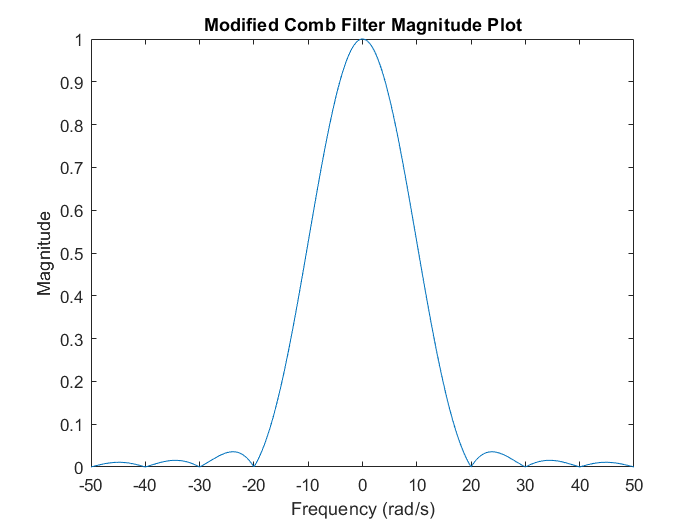

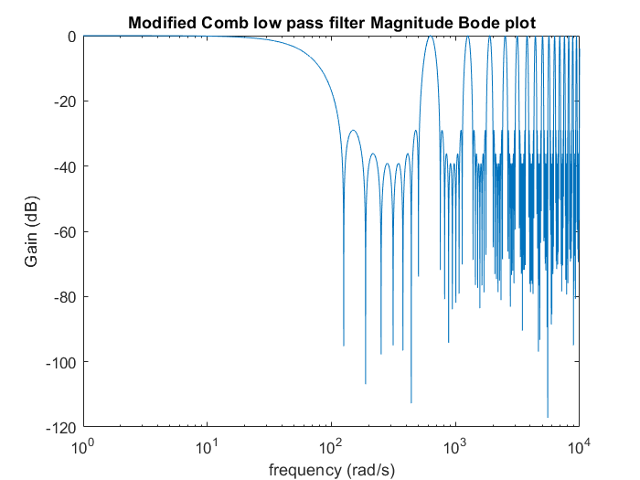
:::

### Combining the two

The FIR filter drops off much faster than the analog filter above 10 Hz. However, its response repeats every 100 Hz, so on its own it would pass any high-frequency content that aliases down into its passband. The analog filter removes that content before the signal is sampled. In series, the combined response falls below the 1 % level (−40 dB) at about 17 Hz. From about 23 Hz upward it stays below −60 dB.

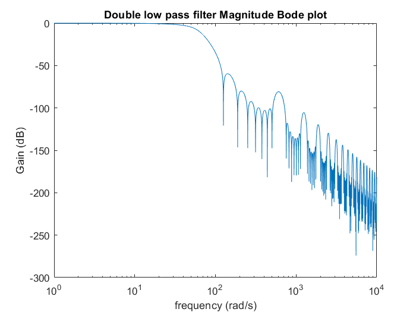{width=70%}

### Why the analog filter has to come first

Swapping the two stages would put the analog filter after the sampler. A filter that acts on sampled data only ever sees frequencies between 0 and 50 Hz, because everything above 50 Hz has already been folded (aliased) back into that range. As a result, the Butterworth filter's response stops falling and instead repeats every 100 Hz:

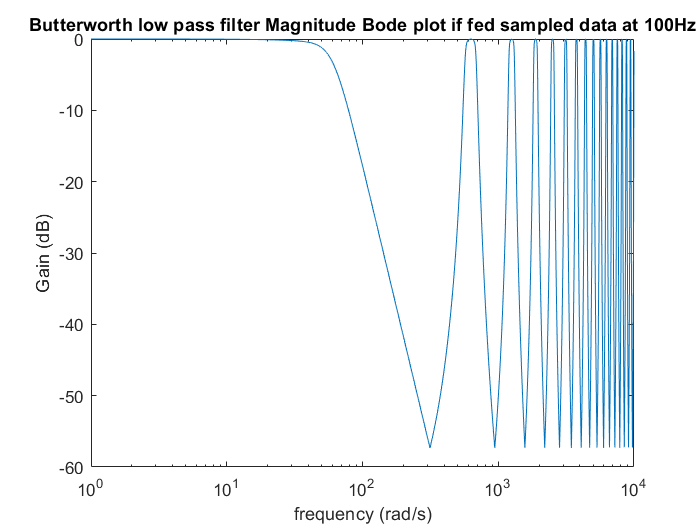{width=70%}

The overlay below compares both orderings against the individual filters:

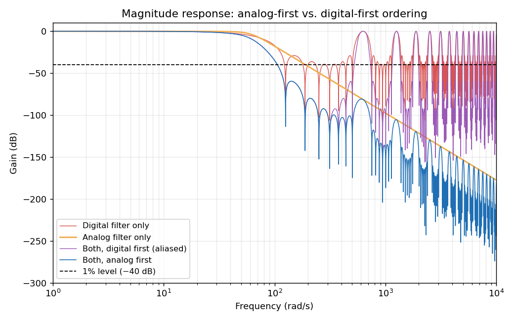

- **Analog first (blue)** keeps falling with frequency. The analog filter suppresses the digital filter's 100 Hz images before sampling, so after the cutoff the cascade never comes back up to the 1 % line.
- **Digital first (purple)** helps between the images, where the aliased analog response still adds some attenuation. Both filters are now periodic, though, so their product is too. It climbs back to 0 dB at every multiple of 100 Hz, exactly like the digital filter alone (red), and any input near those frequencies passes straight through as a low-frequency alias.

Placing the analog filter first makes it the anti-aliasing filter for the digital stage. That is what lets the two filters' strengths combine instead of their weaknesses.

## Implementation

The square wave came from a microcontroller-based signal source, measured on an oscilloscope at **10.7 Hz with a 35 % duty cycle**. The Arduino read the raw square wave on `A0` and the analog filter's output on `A1`. It ran the FIR filter on the analog output and streamed all three signals over serial for analysis in MATLAB.

### Getting the sample rate right

The FIR taps assume exactly $f_s = 100$ Hz, so sampling-rate errors directly shift the digital filter's response. My first version sampled inside `loop()` with a delay. When I analyzed that data, MATLAB measured the square wave at **12.3 Hz**, while the oscilloscope showed 10.7 Hz. The wave averaged 8.13 samples per cycle, so the real sample rate was only

$$
f_s = 8.13 \times 10.7 \approx 87 \text{ samples/s}.
$$

The ADC conversions, the filter math, and the serial printing all added time to every iteration. That was a 13 % error in the rate the filter design depends on. I fixed it in two steps:

- **Timer1 compare-match interrupt.** The sampling and filtering moved into an ISR that fires exactly every 10 ms, independent of how long the rest of the code takes.
- **115200 baud instead of 9600.** Each sample sends three values, roughly 18 characters, so 100 samples per second need about 1,800 characters/s. At 9600 baud the serial port only carries about 960 characters/s. The output buffer filled up, and the prints throttled the whole program.

After these changes, the wave averaged 9.29 samples per cycle, giving $f_s = 99.4$ samples/s, which is within measurement error of 100 Hz. MATLAB then measured the same 10.7 Hz as the oscilloscope. The analog filter's measured ratios were nearly identical in both runs, as expected, because it does not depend on sampling. The digital filter's ratios were not. With the wrong sample rate, it attenuated the fundamental more (ratio 0.42 vs. 0.52) and passed more of the second harmonic (0.12 vs. 0.06).

```{.cpp filename="square_to_sine.ino"}
#include <avr/io.h>
#include <avr/interrupt.h>

const int inputPin = A1;   // analog-filtered signal
const int inputPin2 = A0;  // raw square wave

// FIR filter state and taps
float xstore[] = {0,0,0,0,0,0,0,0};
const float b[] = {0.0382f,0.1f,0.1618f,0.2f,0.2f,0.1618f,0.1f,0.0382f};
float yn = 0;

void setup() {
  Serial.begin(115200);

  cli();                                // disable interrupts during setup
  TCCR1A = 0;
  TCCR1B = 0;
  TCCR1B |= (1 << WGM12);               // CTC mode
  OCR1A = 2499;                         // 16 MHz / (64 * 100 Hz) - 1
  TCCR1B |= (1 << CS11) | (1 << CS10);  // prescaler 64
  TIMSK1 |= (1 << OCIE1A);              // enable compare-match interrupt
  sei();
}

ISR(TIMER1_COMPA_vect) {  // runs every 10 ms
  float xn = analogRead(inputPin)*5.f/1023.f;
  float yu = analogRead(inputPin2)*5.f/1023.f;

  // FIR filter
  for (int i = 0; i < 7; i++) {
    yn += b[i]*xstore[i];
  }

  // shift the delay line
  for (int i = 7; i > 0; i--) {
    xstore[i] = xstore[i-1];
  }
  xstore[0] = xn;

  Serial.print(yu);    // square wave
  Serial.print(" ");
  Serial.print(xn);    // after analog filter
  Serial.print(" ");
  Serial.println(yn);  // after both filters

  yn = 0;
}

void loop() {
}
```

## Results

### Spectral analysis

I took the FFT of the first 1000 samples of each signal. At 100 Hz this gives a 0.1 Hz frequency resolution, so each harmonic of 10.7 Hz falls cleanly in its own bin. A Hann window was applied to all three signals to reduce leakage from the mismatch between the start and end of the record. The resulting magnitudes were multiplied by 2 to correct for the window's amplitude loss. The spectrum from −50 to 50 Hz captures up to the 4th harmonic, which is as far as a 100 Hz sample rate can represent.

::: {layout-ncol=3}
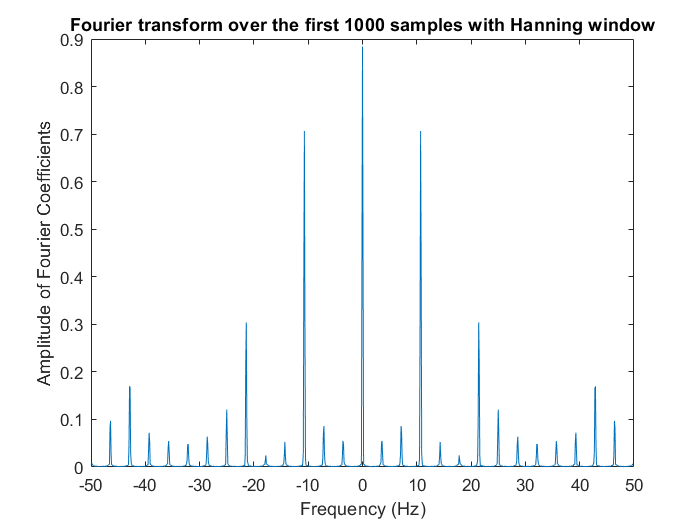

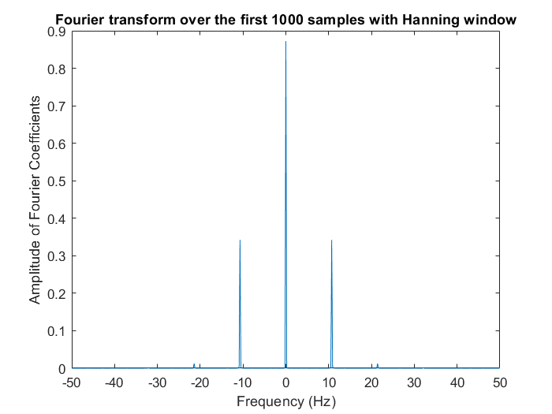


:::

The analog filter alone already leaves something that looks like a sinusoid. The digital stage then removes the remaining 21.4 Hz spike from the second harmonic.

### Measured Fourier coefficients

Fourier coefficient magnitudes $|a_k|$ in volts, where $k$ is the harmonic number:

| Signal | $k = 0$ (DC) | $k = 1$ | $k = 2$ | $k = 3$ |
|---|---|---|---|---|
| Square wave | 1.755 | 1.4054 | 0.6143 | 0.0814 |
| After analog filter | 1.745 | 0.6838 | 0.0252 | 0.0030 |
| After both filters | 1.679 | 0.3440 | 0.0011 | 0.00015 |

The square wave's coefficients match the theory for a 35 % duty cycle, $|a_k| = \frac{A\sin(k\pi d)}{k\pi}$. The third harmonic is small because $3 \times 0.35$ is close to an integer, which puts it near a zero of the sinc envelope.

### Measured vs. expected filter gains

Each value is the ratio of a stage's output coefficient to its input coefficient. The expected values come from evaluating $|H(j\omega)|$ and $|H_D(e^{j\omega T})|$ at 10.7 Hz and its harmonics.

| Stage | | $k = 0$ | $k = 1$ | $k = 2$ | $k = 3$ |
|---|---|---|---|---|---|
| Analog | measured | 0.9945 | 0.4866 | 0.0410 | 0.0369 |
| | expected | 1 | 0.5281 | 0.0401 | 0.0080 |
| Digital | measured | 0.9619 | 0.5030 | 0.0453 | 0.0510 |
| | expected | 1 | 0.4744 | 0.0223 | 0.0112 |
| **Both** | **measured** | **0.9566** | **0.2447** | **0.0019** | **0.0019** |
| | **expected** | **1** | **0.2505** | **0.0009** | **0.00009** |

The fundamental, which is the part of the signal we want to keep, matches the prediction within **2.3 %** through the full chain. The analog stage's second-harmonic gain also matches closely (0.041 vs. 0.040).

The higher harmonics are off by up to an order of magnitude, but they are limited by the ADC, not by the filters. The Arduino's 10-bit ADC has a resolution of 1 LSB = 4.9 mV and an absolute accuracy of ±2 LSB. After the analog stage, the third harmonic is a sinusoid of only $2 \times 0.0030 = 6$ mV, which is about one LSB. After both stages, the largest remaining harmonic is about 2 mV, below the smallest step the ADC can resolve. At these levels the measured ratios reflect quantization noise, and the true attenuation is at least as good as the ADC can show. The remaining differences in the analog stage are consistent with the ±10 % tolerance of the resistors and capacitors.

::: {.callout-note collapse="true"}
## MATLAB analysis script

```matlab
T = readmatrix('square_to_sine_data.txt');
squarewave  = T(:,1);
analogwave  = T(:,2);
digitalwave = T(:,3);
Freq = 10.7;   % square wave frequency (Hz), from the oscilloscope
fs   = 100;    % sample rate (Hz)

% Spectra of the first 1000 samples with a Hann window (x2 amplitude correction)
N = 1000;
w = hann(N);
[Xs, f] = fdomain(squarewave(1:N).*w,  N/fs);
[Xa, ~] = fdomain(analogwave(1:N).*w,  N/fs);
[Xd, ~] = fdomain(digitalwave(1:N).*w, N/fs);

% Bins for DC and the first three harmonics (0.1 Hz resolution, DC at bin 501)
idx = 501 + round(10*Freq*(0:3));
aksquare  = 2*abs(Xs(idx));
akanalog  = 2*abs(Xa(idx));
akdigital = 2*abs(Xd(idx));

analogratios  = akanalog./aksquare;
digitalratios = akdigital./akanalog;
bothratios    = akdigital./aksquare;

% Analog filter: two Sallen-Key stages
R11 = 47e3;  R12 = 270e3;  C1 = 0.22e-6;  C2 = 0.1e-6;
R21 = 27e3;  R22 = 100e3;  C3 = 1e-6;
H = @(s) 1./((s.^2*R11*R12*C1*C2 + (R11+R12)*C2*s + 1) .* ...
             (s.^2*R21*R22*C3*C2 + (R21+R22)*C2*s + 1));

% Digital filter: comb 1 - z^-10 with the DC and 10 Hz zeros removed
Ncomb = [1 zeros(1,9) -1];
P = conv([1 -1], [1 -2*cos(pi/5) 1]);
b = deconv(Ncomb, P);
b = b/sum(b);                       % unity DC gain
HD = @(z) polyval(b, z.^(-1));

% Expected gains at DC and the first three harmonics
k = 0:3;
analogtheory  = abs(H(1j*2*pi*Freq*k));
digitaltheory = abs(HD(exp(1j*2*pi*Freq*k/fs)));
boththeory    = analogtheory.*digitaltheory;
```
:::

## Takeaways

- Splitting the work between an analog and a digital filter gave a better result than either could alone. The analog stage handles anti-aliasing, and the digital stage provides the sharp cutoff.
- A digital filter is only as accurate as its sample clock. A 13 % timing error from a delay-based loop measurably changed the filter's response, and a hardware timer interrupt fixed it.
- The measured attenuation of the higher harmonics was limited by the ADC, not by the filters. Verifying the filters further would require a higher-resolution ADC or a larger input signal, not a different filter design.
