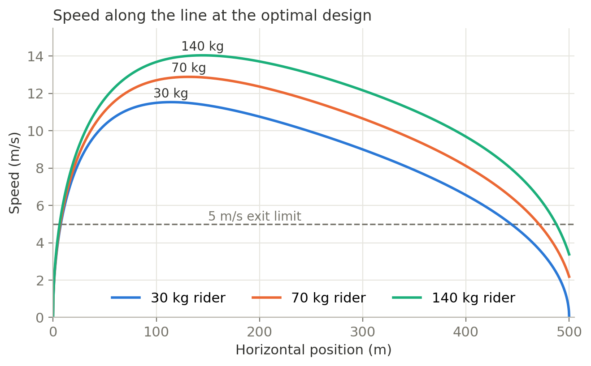
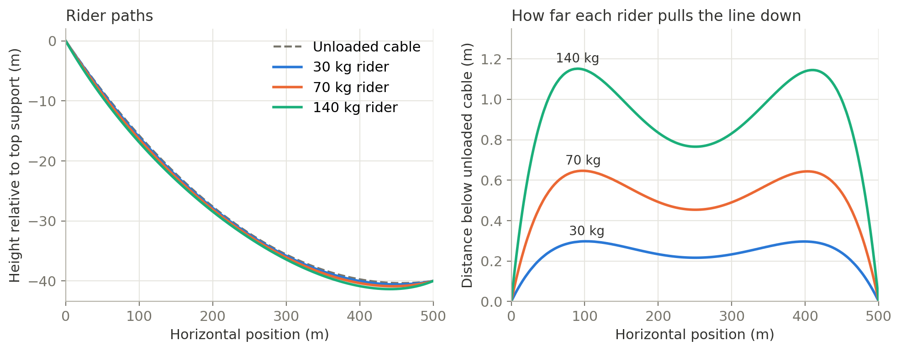
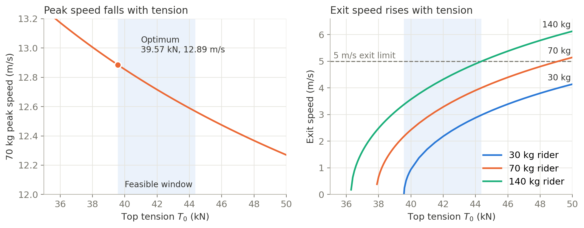
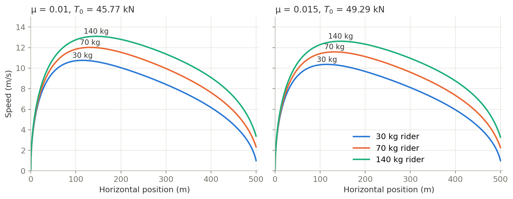

## Overview

A zipline has two settings that are fixed before anyone rides it: the vertical drop between its supports and the tension in its wire rope. A slack line is fast, but light riders may stop short of the end. A tight line gets everyone there, but it is slower at the top and heavier riders may arrive too quickly.

In this project I modeled the ride numerically and optimized both settings for a 500 m line with no wind. The goal was to make a 70 kg rider's peak speed as high as possible, while meeting these constraints:

- **Every rider finishes.** Riders of 30 kg, 70 kg, and 140 kg must all reach the end from a standing start.
- **Exit speed stays safe.** No rider can leave the line faster than 5 m/s.
- **The design stays in range.** The drop must be 10 to 40 m, and the tension can be at most 50 kN.

The best design uses the full **40 m drop** with **39.6 kN of tension**, which gives the 70 kg rider a peak speed of **12.9 m/s**. The limit is set by the 30 kg rider, who only just reaches the end at this tension.

*Developed for Harvey Mudd's Engineering Math course (E72). The equations for the rider's path come from a paper provided by the course.*

{width=70%}

## Model

### Line shape

With no rider, the wire rope hangs as a catenary. Its shape depends on two parameters, $a_0$ and $b_0$, where $a_0$ is the slope at the top and $b_0$ is the change in slope along the line. Together with the rope length $L$, they follow from three conditions: the line must span $X = 500$ m horizontally, it must drop by $Y$, and the top tension $T_0$ must balance the rope's weight, $w = 15$ N/m:

$$
\frac{X}{L} = \frac{1}{b_0}\ln\frac{a_0 + \sqrt{1 + a_0^2}}{a_0 - b_0 + \sqrt{1 + (a_0 - b_0)^2}},
\qquad
\frac{Y}{L} = \frac{\sqrt{1 + a_0^2} - \sqrt{1 + (a_0 - b_0)^2}}{b_0},
\qquad
T_0\cos\theta_0 = \frac{wL}{b_0}
$$

where $\tan\theta_0 = a_0$. A rider adds a point load, which puts a kink in the line and changes its whole shape. So the path a rider follows is not the shape of the line at any single moment. For each rider I solved for the loaded shape's own parameters $a$ and $b$ at 101 positions along the rope, then fit a spline through the rider's location at each one to get the path $y(x)$.

Rider speed is much lower than the speed of waves in the cable, so the two problems can be separated. The rider's position sets the line's shape, but the rider's acceleration does not noticeably affect it.



All of the paths dip below the end of the line, reaching their lowest point around $x = 445$ m. That means the last stretch of every ride is uphill, by 0.6 m for the 30 kg rider and 1.4 m for the 140 kg rider.

### Rider speed

The forces along the line are gravity and air drag. With $\alpha = \tan^{-1}(dy/dx)$, the equation of motion is

$$
m\frac{dv}{dt} = mg\sin(-\alpha) - \frac{1}{2}\rho C_d A v^2
$$

where $\rho = 1.2$ kg/m³, $C_d = 1$, and the frontal area of a seated rider is $A = 0.05\,m^{2/3}$ m². The path is known as a function of $x$, not $t$, so I rewrote this in terms of position. Using $v^2$ as the variable makes the drag term linear and removes the square root from the state:

$$
\frac{d(v^2)}{dx} = 2\left(g\sin(-\alpha) - \frac{\rho C_d A}{2m}v^2\right)\sqrt{1 + \left(\frac{dy}{dx}\right)^2}
$$

In the code, the state `v` holds $v^2$, and `dydxeval` is the derivative of the path spline:

```{.matlab filename="equation of motion"}
oscillatingdiffeq=@(x,v) [2*(g*sin(-atan(dydxeval(x)))-(0.5*A(suspect)*pair.*v)/masses(suspect))*sqrt(1+(dydxeval(x)).^2) ];
oscillatingsol=ode45(oscillatingdiffeq,[0,xfinal],initdata);
```

## Optimization

Each candidate drop and tension goes through the same steps:

1. Solve the three equations above for the unloaded line with `fsolve`.
2. Solve for the loaded shape at each of the 101 rider positions, starting each solve from the previous answer.
3. Fit the rider's path with a spline and differentiate it.
4. Integrate the speed equation along the line with `ode45`.

### Solving for the line shape

The unloaded line comes first. Here `bigxt` and `bigyt` are the $X/L$ and $Y/L$ expressions from the model, and the unknowns are `v = [a0, b0, L]`:

```{.matlab filename="unloaded line"}
fvect = @(v) [bigxt(v(1),v(2)) - X/v(3),bigyt(v(1),v(2)) - Y/v(3),T0*cos(atan(v(1)))-v(3)*pz/v(2)];
x = fsolve(fvect,[0.2,0.2,500],optimset('Display', 'Off'));%solve for a0, b0, and L
```

With a rider on the line, the rope before and after the rider must still span the same $X$ and $Y$ together. `f` is the fraction of the rope the rider has passed, and `gamma` is the rider's weight divided by the rope's. The shape changes only a little from one position to the next, so each solve starts from the previous answer:

```{.matlab filename="loaded line"}
gammaa = masses.*g/(x(3)*pz);% make gamma arrays
a0 = x(1);
b0 = x(2);
%find local a and b for zipline [a,b]:
prevab = [a0,b0];% predict a and b originally to be a0 and b0
fvals = 0:0.01:1;
for i = 1:length(fvals)
  gamma = gammaa(suspect);
  f = (i-1)/100;
  abvect = @(v) [sxt(v(1),v(2),f)+sxtp(v(1),v(2),f,gamma)-bigxt(a0,b0),syt(v(1),v(2),f)+sytp(v(1),v(2),f,gamma)-bigyt(a0,b0)];
  ab = fsolve(abvect,prevab,optimset('Display', 'Off'));
  asols(i) = ab(1);
  bsols(i) = ab(2);
  prevab = ab; %use last a and b values as the prediction for the next ones
end
```

### Building the rider's path

Each solved shape gives one point on the rider's path. The speed equation needs $dy/dx$ at any $x$ that `ode45` asks for, not only at these 101 points, so I fit a spline through them and differentiate the spline:

```{.matlab filename="path spline"}
for i = 1:length(fvals) %finding x and y values that match in time
  xvals(i) = x(3)*sxt(asols(i),bsols(i),fvals(i));
  yvals(i) = -x(3)*syt(asols(i),bsols(i),fvals(i));
end
xytspline = spline(xvals,yvals);
dxytspline = fnder(xytspline, 1); %find dy/dx(x)
dydxeval = @(x) ppval(dxytspline, x); %define the spline like this to access it later
```

### Searching the design

`fmincon` searches over the drop and tension, starting from 39 m and 39 kN and staying inside the allowed ranges:

```{.matlab filename="optimizer"}
opts = optimset('Algorithm','interior-point','DiffMinChange',1e-0);
anzguer = fmincon(@zipline,[39,39000],[],[],[],[],[10,0],[40,50000],[],opts);
```

The objective is the negative of the 70 kg rider's peak $v^2$, so minimizing it maximizes speed. It returns a large penalty if an exit constraint fails:

```{.matlab filename="constraint penalties"}
if (velocities(2001)<0)    % v^2 at the exit: rider did not arrive
    output = 100-10*velocities(2001);
    loop = 5;
end
if (velocities(2001)>25)   % exit speed above 5 m/s
    output = 100+10*velocities(2001);
    loop = 5;
end
```

Each rider takes about a hundred solves, so the code checks the riders in order of how likely they are to fail: 30 kg first, then 140 kg, then 70 kg. A design that fails an exit check stops immediately, without the work of solving for the other riders:

```{.matlab filename="rider order"}
switch loop %This gives the priority on which person we check, first the 30kg, then 140kg then 70kg.
  case 2; output = -max(velocities); loop = 5;
  case 3; loop = 2;
  case 1; loop = 3;
  otherwise; loop = 5;
end% this switch case minimizes the number of times we solve differential equations and fsolves
```

## Results

| Rider | Peak speed | Peak location | Exit speed |
|---|---|---|---|
| 30 kg | 11.53 m/s | $x$ = 114 m | 0.02 m/s |
| 70 kg | **12.89 m/s** | $x$ = 131 m | 2.18 m/s |
| 140 kg | 14.04 m/s | $x$ = 145 m | 3.38 m/s |

: Results for the optimal design, a 40 m drop with $T_0$ = 39.57 kN

Drag dominates the ride. Without it, a 40 m drop could give a rider up to 28 m/s, but the 70 kg rider peaks at less than half of that and leaves with about 0.6 % of the energy released by the drop.

The 30 kg rider sets the limit because drag matters more for lighter riders. Frontal area grows more slowly than mass, so the drag deceleration at a given speed scales with $m^{-1/3}$. At the same speed, a 30 kg rider slows down about 1.7 times as fast as a 140 kg rider, and reaches the final uphill stretch with the least energy.

### Checking the optimum

`fmincon` is a local optimizer, and the penalties make this objective jump at the edges of the allowed region, so I checked the result with separate sweeps of tension and drop. With the drop fixed at 40 m, tension trades peak speed against exit speed:



The allowed range runs from 39.57 kN, where the 30 kg rider first reaches the end, to 44.37 kN, where the 140 kg rider reaches the 5 m/s limit. Peak speed falls steadily with tension, from 12.89 to 12.57 m/s across this range. The best design is therefore the lowest tension that still works, which puts it right on the 30 kg rider's constraint.

The optimizer also pushed the drop to its 40 m limit. To see why, I found the lowest working tension at each drop:

| Drop | Lowest working tension | 70 kg peak speed |
|---|---|---|
| 32.5 m | 48.41 kN | 11.63 m/s |
| 35 m | 45.03 kN | 12.06 m/s |
| 37.5 m | 42.12 kN | 12.48 m/s |
| 40 m | 39.57 kN | 12.89 m/s |

A larger drop helps twice: it gives riders more potential energy, and it lets the line run at a lower tension. Peak speed rises at every step, so the optimum sits at the 40 m limit. At drops of 30 m or less, the 30 kg rider cannot finish at any tension up to 50 kN.

## Adding friction and a safety margin

The optimum has a weakness. The 30 kg rider exits at only 0.02 m/s, and the result is very sensitive to tension: at 39,700 N the exit speed is 0.52 m/s, while at 39,570 N the rider stops short of the end. A real line also has friction, which the model above ignores.

To make the design more realistic, I added friction with coefficient $\mu$ and required an exit speed of at least 1 m/s. The friction force uses the normal force from the rider's weight, ignoring the smaller term from the line's curvature:

$$
\frac{dv}{dt} = g\sin(-\alpha) - \mu g\cos\alpha - \frac{\rho C_d A}{2m}v^2
$$

In the code, this adds one term to the equation of motion, shown here for $\mu = 0.015$. The exit check also changes from $v^2 < 0$ to $v^2 < 1$:

```{.matlab filename="equation of motion with friction"}
oscillatingdiffeq=@(x,v) [2*(-0.015*g*cos(-atan(dydxeval(x)))+g*sin(-atan(dydxeval(x)))-(0.5*A(suspect)*pair.*v)/masses(suspect))*sqrt(1+(dydxeval(x)).^2) ];
```

| $\mu$ | $T_0$ | Peak speed (30 / 70 / 140 kg) | Exit speed (30 / 70 / 140 kg) |
|---|---|---|---|
| 0 (no margin) | 39.57 kN | 11.53 / 12.89 / 14.04 m/s | 0.02 / 2.18 / 3.38 m/s |
| 0.01 | 45.77 kN | 10.76 / 12.02 / 13.09 m/s | 1.00 / 2.33 / 3.39 m/s |
| 0.015 | 49.29 kN | 10.36 / 11.58 / 12.62 m/s | 1.00 / 2.27 / 3.29 m/s |



The pattern stays the same. The optimum still uses the full 40 m drop and the lowest tension that gets the 30 kg rider to the end at the required speed. Friction just raises that tension. At the 50 kN limit, the 1 m/s margin can only be met up to about $\mu = 0.016$. Beyond that, no allowed tension gets the lightest rider to the end at that speed.

## Assumptions and limits

- The cable does not stretch, its weight is uniform, and its supports do not move.
- There is no wind, and air density, gravity, $C_d$, and $A$ are constant.
- Every rider starts from rest.
- There is no friction, except in the friction study above.
- The 50 kN limit applies to $T_0$, the top tension with no rider on the line.

The last assumption matters. Adding a rider raises the tension. Using the model's loaded shapes, a 140 kg rider brings the top tension to about 50.7 kN in the base design and 63.2 kN in the $\mu = 0.015$ design. A cable that cannot stretch likely overstates this, and these values are far below the line's breaking strength of five times the limit, but a real design should apply the limit under load.

## Takeaways

- The best design sits on a constraint, not at a smooth peak. Peak speed keeps rising as tension falls, right up until the lightest rider stops arriving.
- An optimum on a constraint leaves no margin. A change of a few newtons decided whether the 30 kg rider finished, so the 1 m/s requirement made the design much more usable.
- A local optimizer's answer is worth checking. The sweeps confirmed the result and also showed why it was the answer, which a single number from `fmincon` could not.
