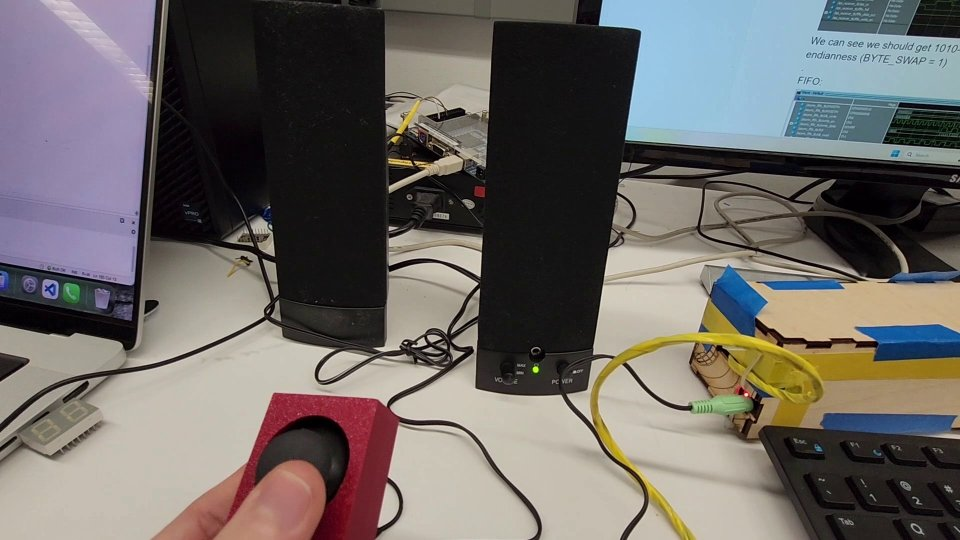
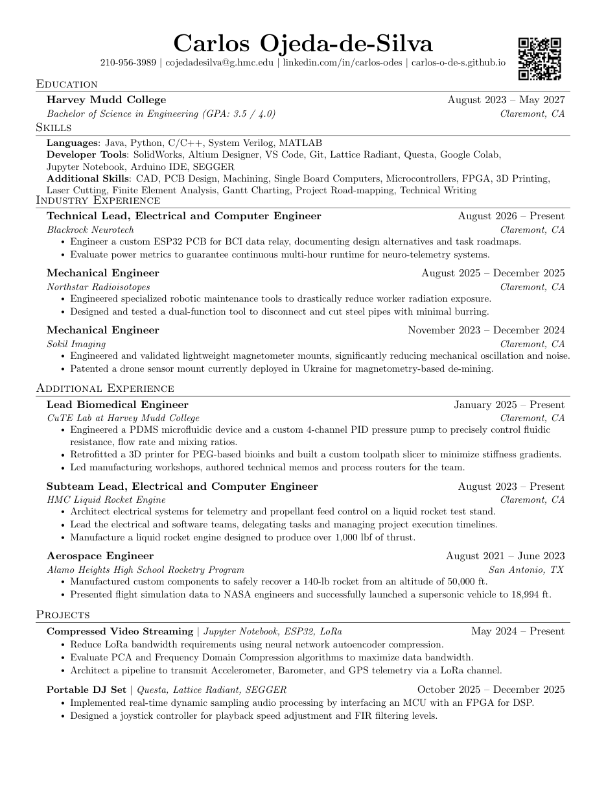

::: {.home}

::: {.hero}
{.hero-photo fig-alt="Headshot of Carlos Ojeda de Silva"}

::: {.hero-text}
# Carlos Ojeda de Silva

I am an Engineering student at **[Harvey Mudd College](https://hmc.edu)**.
While studying a general engineering degree, I focus my learning on projects, mainly in Mechanical Design and Computer Science, from rockets and avionics to FPGAs and machine learning.

[<i class="bi bi-linkedin"></i> LinkedIn](https://www.linkedin.com/in/carlos-odes/){.btn .btn-outline-primary .btn-sm}
[<i class="bi bi-github"></i> GitHub](https://github.com/cojedadesilva){.btn .btn-outline-primary .btn-sm}
[<i class="bi bi-file-earmark-pdf"></i> Resume](Resume/resume.qmd){.btn .btn-outline-primary .btn-sm}
:::
:::

## Engineering Projects

::: {#engineering}
:::

## Portable DJ Set &middot; E155 Final Project {#dj-set}

::: {.feature-card}
[{fig-alt="The portable DJ set: joystick controller next to speakers"}](E155FinalProject/index.qmd)

::: {.feature-body}
### [Portable DJ Set](E155FinalProject/index.qmd)

Built with Maynor for HMC's Microprocessors class: an MCU streams songs from a microSD card to an FPGA, which applies a live high/low-pass filter and changes playback speed, all controlled with a joystick.

[Overview](E155FinalProject/index.qmd){.btn .btn-primary .btn-sm}
[FPGA Design](E155FinalProject/fpgaD.qmd){.btn .btn-outline-secondary .btn-sm}
[MCU Design](E155FinalProject/mcuD.qmd){.btn .btn-outline-secondary .btn-sm}
[Results & Demo](E155FinalProject/results.qmd){.btn .btn-outline-secondary .btn-sm}
:::
:::

## Systems & Controls Projects

::: {#controls}
:::

## CS & Math Projects

::: {#cs-math}
:::

## E155 Microprocessor Labs

::: {#labs}
:::

## Resume

::: {.feature-card .resume-card}
[{fig-alt="Preview of the first page of Carlos's resume"}](Resume/resume.qmd)

::: {.feature-body}
### CV / Resume

My education, experience, and skills in one page.

[View Resume](Resume/resume.qmd){.btn .btn-primary .btn-sm}
[Download PDF](Resume/Carlos_Ojeda_CV_Resume.pdf){.btn .btn-outline-secondary .btn-sm download="Carlos_Ojeda_CV_Resume.pdf"}
:::
:::

## Why I Enjoy Learning from Experimentation

Over the last couple of years, I have learned that doing projects based on areas of interest is the best way to learn. Setting yourself a challenge in the form of a project idea forces you to learn all the background information needed to complete it. This ensured I understood the topics studied well enough to apply them in the real world.

This is why I like to challenge myself with new projects. I feel that the learning that results from experimenting is better than simply reading it in a textbook. I often enjoy setting up challenges with constraints because it is more challenging and interesting.

:::
