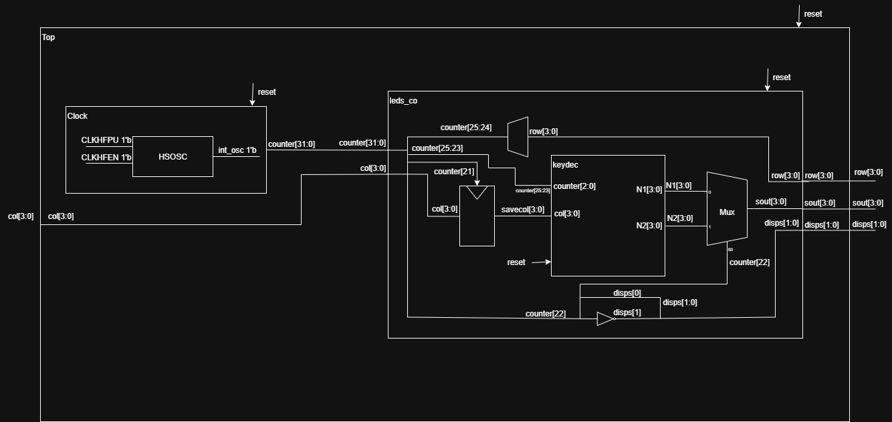
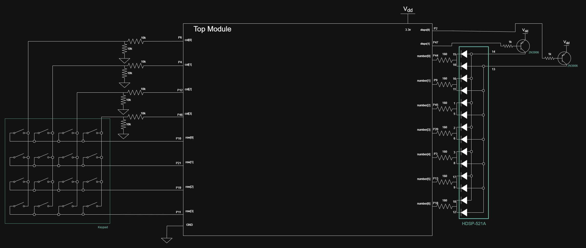
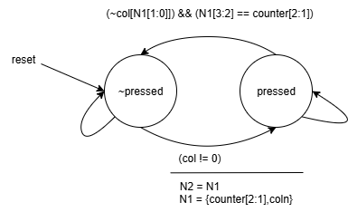
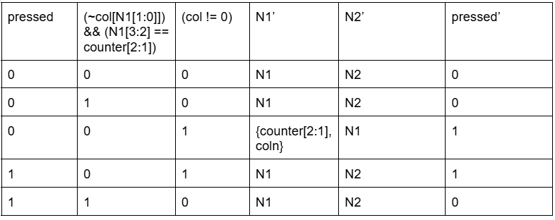
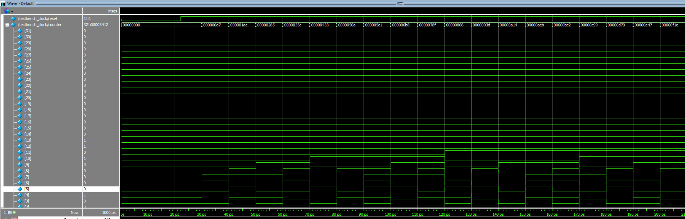
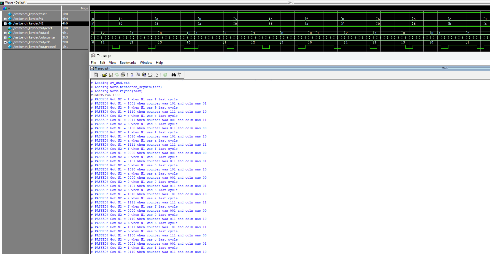
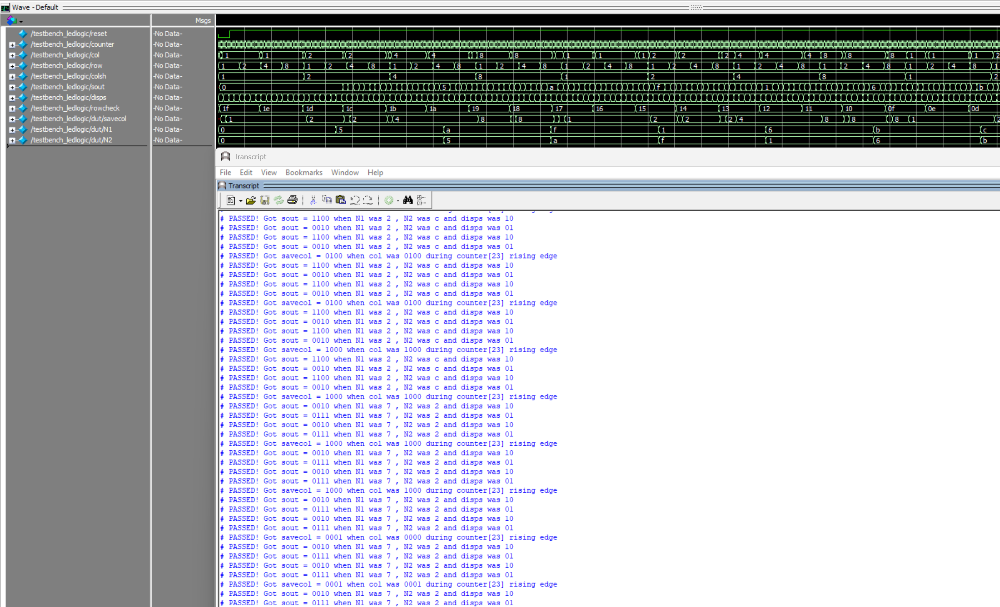
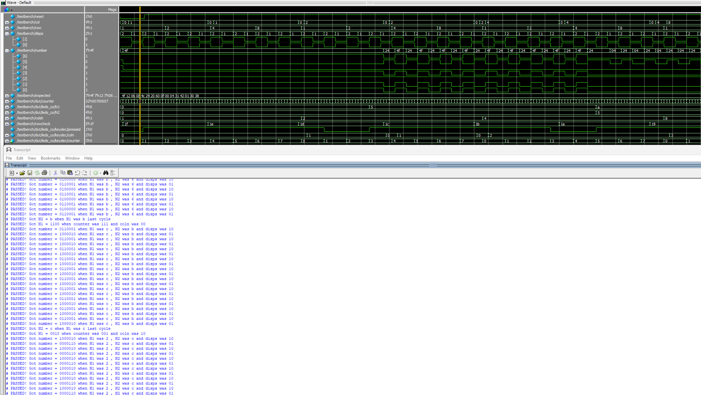
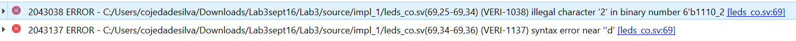

::: {.callout-tip appearance="simple" icon=false title="At a glance"}
**Goal:** Scan a 4x4 keypad with the FPGA, debounce the presses, and show the two most recent keys on a dual 7-segment display.

**My work (individual lab):** Designed the row-scanning and debouncing scheme and its finite state machine, wrote the keypad decoder and display logic in SystemVerilog, wired the keypad and display circuit, and wrote a testbench for each module.

**Result:** Every module testbench passed, and on hardware each new key appears on the right digit while the previous one shifts left (see the demo video). Time spent: 18 hours.
:::

In this individual lab, I was tasked to make a display for a 4x4 keyboard that would show a different hex number after pressing a button, saving two numbers at a time. 

### Demo

Pressing keys on the keypad: the newest digit appears on the right display and the previous one shifts to the left.



### Electrical calculations

In Lab 1, I used 5v as the V_in of the 7 segment display, which makes the display bleed a bit of current into every LED when off since 3.3v < 5v. This was fixed by changing the V_in to 3.3v and recalculating the required resistance to be:

For these LED's, I used a 160Ω resistor

Voltage drop of around 0.4V in the transistor, a red LED has a voltage drop of around 1.8v at the current we are driving them at, so:

$$
0.010 > \frac{3.3-0.4-1.8}{R}
$$
$$
R > 110
$$

For the transistor, we need to calculate the resistor that we will connect to the base:
The desired base current is between 2-3 mA based on the datasheet and our desired output current (up to 70mA) and the voltage drop would be around 0.95V, we need to account that the total voltage is 3.3v, so:

$$
R = \frac{3.3-0.95}{0.005}
$$
$$
R = 470
$$

In this case, I also chose 10mA for the 7 segment display since the datasheet does recommend a value closer to that, and it was very visible. The selected value was 160Ω. This value was also used for the normal LED's used in the fulladder since they have similar current needs and voltage drops.

This also corresponds to the current ratings of the 2N3906 Transistor we are using, which allows a maximum of 200mA to be drawn, meaning that having all segments on (7 per transistor) results in a total current draw of <70mA.

### Block Diagram

{fig-alt="Lab 3 block diagram: the HSOSC clock feeds a 32-bit counter; inside leds_co, counter bits drive the keypad rows, latch the column reading, and clock the keydec decoder that stores keys N1 and N2, and a mux selects which key goes to the display"}

### Circuit Diagram

{fig-alt="Lab 3 circuit: a 4x4 keypad with its rows driven by FPGA pins and its columns read through 10 kilohm resistors with 10 kilohm pull-downs, plus a dual HDSP-521A display with 160 ohm segment resistors and two 2N3906 transistors"}

### General Overview of the system/code

The current code made works in an interesting way. I first defined a top module that is in charge of getting the clock and sending the calculated sout (data on specific hex number to display at a given time) to the sevseg module that controls the seven segment display. The other module it calls is leds_co, which is in charge of managing all the seven segment LED logic, where we have to flip back and forth to only use 9 pins instead of 14 (more on this in lab2 website).

In this case, we need to drive the rows at different times and read the columns, to prevent bouncing in the buttons and drive power to rows, I used the counter, specifically the range [25:23] and [21], where the 21st bit will save col -> savecol on the rising edge. In order to control the row output, we use the range [25:24], where we use the left shift operator to make the sequence, where this value can be anything from 0 to 3. 

1 << 0 = 0001   
1 << 1 = 0010   
1 << 2 = 0100   
1 << 3 = 1000   

Then it repeats

The 23rd bit is used in the keypad decoder code where we only act on the rising edge of this bit since this is halfway from a row being assigned and it being unassigned, meaning any start behaviour and end behavior noise we get should not fall in the middle. generally this can be done by adding counters that check the signal a specific time after the row is switched (less robust), or other methods to reduce this noise may include low pass filters (not ideal for digital electronics since voltage in capacitors takes time to rise) or reducing frequency to reduce the percent of time where you have noise (ideally avoided to reduce unnecessary noise)

The debouncer logic (shown below) works in a simple manner, where we start in the ~pressed state, this means we aren't actively pressing the button. when something gets detected, col would not be 0, which is when we set N2 = N1 and N1 = {counter[2:1],coln}, where:

counter[2:1] is the same part of the counter that controls row. Note that this variable inside the keydec module is different from the 32 bit counter.
coln is defined as the column number, where we use if statements to the opposite to when we assigned rows:

0001 --> 0  
001x --> 1  
01xx --> 2  
1xxx --> 3  

In the code, I chose to use if statements instead of assuming that x were 0 since if you would press 3 buttons at once and release the first one that was detected, it could default to the first column, which is unpredictable behaviour we like to avoid.

### FSM

{fig-alt="Two-state debouncer FSM: from not-pressed it moves to pressed when a column reads nonzero, shifting N1 into N2 and storing the new key in N1, and it returns to not-pressed when that key is released"}

{fig-alt="State transition table for the debouncer listing the current state, the release and press conditions, and the next values of N1, N2, and pressed"}

Note: the FSM changes states on the rising edge of counter[23], not the clock directly.

### Testbenches

{fig-alt="ModelSim waveform of the counter testbench showing the 32-bit counter incrementing after reset"}

{fig-alt="ModelSim waveform and transcript for the keypad decoder testbench, where every check of the stored keys N1 and N2 prints PASSED"}

{fig-alt="ModelSim waveform and transcript for the LED logic testbench, where every check of the displayed digit and saved column prints PASSED"}

{fig-alt="ModelSim waveform and transcript for the top-level testbench, where every check of the segment output and stored keys prints PASSED"}

### AI Prototype

Doing it all at once:

{fig-alt="Lattice Radiant error: unexpected end of file in the AI-generated top.sv"}

The AI gave me all the modules at once, but it looks like it ran out of space and gave me a partial top module as seen as the upper error.

After asking the AI to redo the top module, it got confused of the other module names and got more errors. I have to either probably use option B to try get each module individually, or buy premium AI use (used free access)

Using option B, I got:

{fig-alt="Lattice Radiant errors in the AI-generated leds_co.sv: an illegal character in a binary number and a syntax error"}

which basically means that the AI messed up some basic syntax. This is probably a quick fix that the AI would be able to fix if we input the errors and it will give us a nicer output. 

Overall, I noticed with both of these solutions that the AI response was way longer than my code, which could mean the AI actually knows how to code, or it is overseeing a lot of easy ways to make a verilog code more compact.

### Resources:

Verilog Code:
<https://github.com/cojedadesilva/E155_Labcode_CODS/tree/main/lab3>

Lab2 Code:
<https://github.com/cojedadesilva/E155_Labcode_CODS/tree/main/lab2>

HDSP-521A datasheet:
<https://docs.broadcom.com/doc/HDSP-521A-523A-Dual-Digit-General-Purpose-7-Segment-Display-DS>

Transistor datasheet:
<https://www.onsemi.com/pdf/datasheet/2n3906-d.pdf>