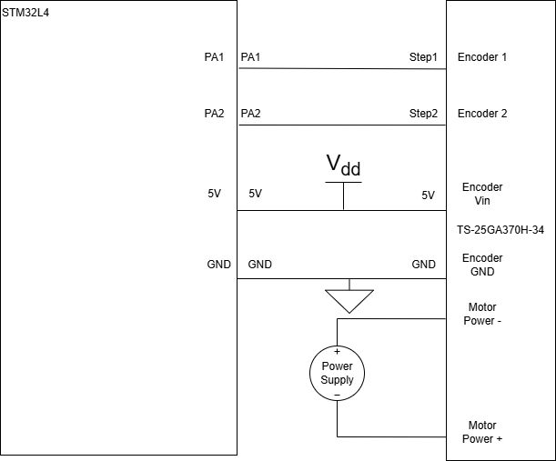
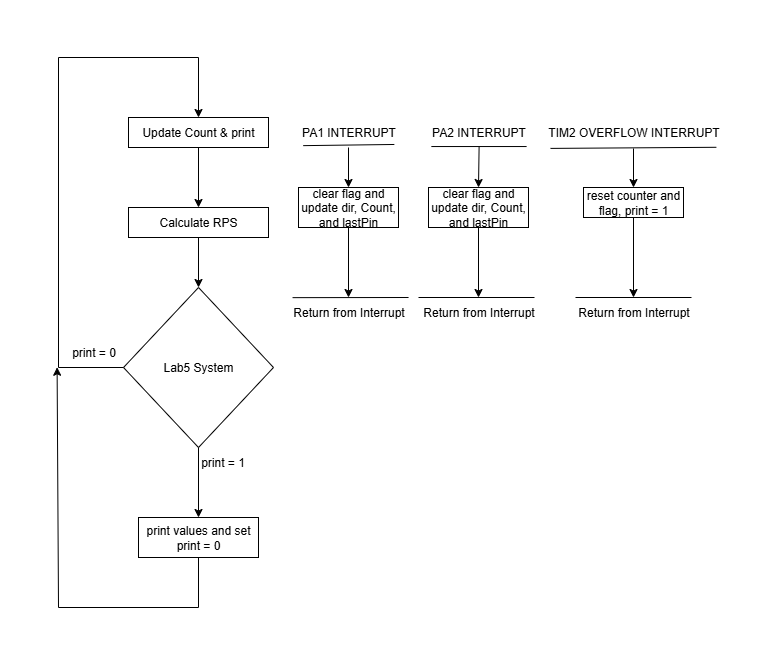
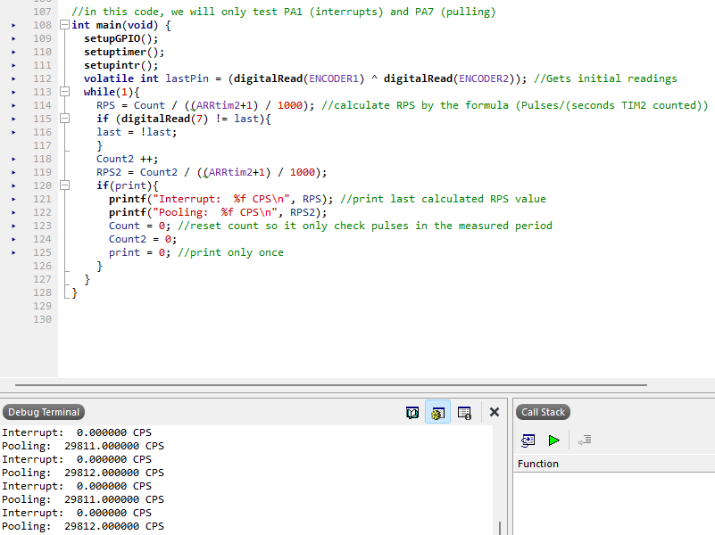
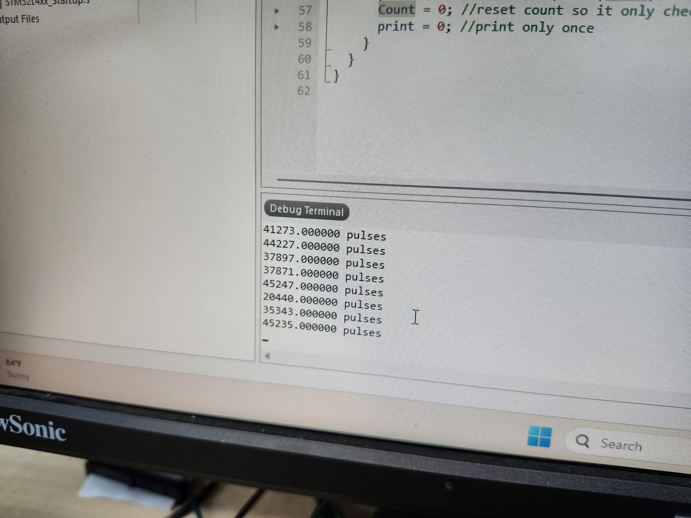
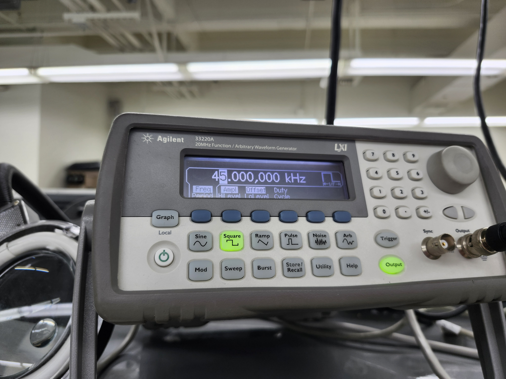
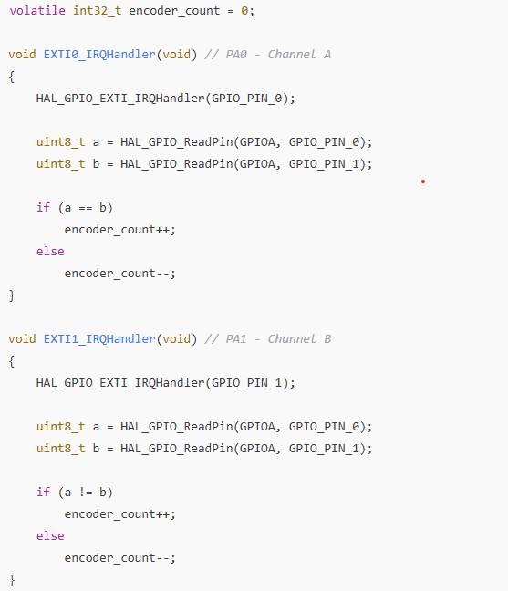

::: {.callout-tip appearance="simple" icon=false title="At a glance"}
**Goal:** Measure a DC motor's speed and direction from its quadrature encoder on an STM32L4, using interrupts instead of polling.

**My work (individual lab):** Wrote the interrupt-driven firmware (one external interrupt per encoder channel plus a 1 Hz timer interrupt for reporting), derived the counts-to-speed math, and compared interrupts against polling.

**Result:** At about 12 V the unloaded motor read 2.7 rev/s against its 2.5 rev/s (150 RPM) rating, and a stopwatch check gave 1.02 rev/s against a reading of 1.007. Interrupts kept up with inputs up to about 45 kHz, well past what the polling loop could resolve. Time spent: 17 hours.
:::

In this individual lab, I made an encoder to measure and calculate the revolutions per minute a motor goes. This was successful, and I know the motor doesn't skip any pulses based on the fact that if it would miss a pulse it would mess up the readings really bad (switch in direction).

### Demo

The motor running from the bench power supply while the encoder interrupts measure its speed.



### Electrical Schematic

{fig-alt="Lab 5 schematic: STM32L4 pins PA1 and PA2 read the two encoder channels of a TS-25GA370H-34 motor, which shares 5 V and ground with the MCU and is powered by a bench supply"}

Note, polarity and voltage of power supply is not specified, this affects RPS and direction

### Code Flowchart

{fig-alt="Firmware flowchart: the main loop calculates speed and prints when a flag is set; the PA1 and PA2 interrupts update the count and direction; the TIM2 overflow interrupt sets the print flag"}

### Design Choices and Math:

For the 1Hz refreshing of data, I used the 1ms Timer 2 clock and made it create an interrupt whenever it overflowed with an ARR value of 999, meaning that the frequency we would get from this would be:

(999+1 pulses) / (1000 pulses/s) = 1second

This is good also because it is asynchronous and will not lag with the External Interrupts.

The motor has 408 pulses per revolution, which if we have 2 channels and a rising and falling edge, this means we get 408*4 = 1632 counts per revolution. 

to calculate RPS, we do:

Counts / (4x408x(999+1)/(1000)), where Counts is the amount of rising and falling edges in both PA1 and PA2. 408*4 is the counts per revolution, and (999+1)/(1000) is the duration of the timer

if we get 1632 counts in 1 second, we get:
1632 / (4x408x(999+1)/(1000)) = 1 rps, which is expected

When running at around 12v, I read an RPS value of around 2.7, which is close to the rated 150RPM (2.5RPS), which could also be a bit higher since we don't have a load on the motor.

Another test done is that when the voltage is set at a value that will make the RPS we read to be around 1 (closer to 1.007) I counted 60 steps while timing and read a time of 58.90 seconds, which is 60/58.9 = 1.02rps, which is very close to 1.007

### Why interrupts are better than polling?

{fig-alt="Polling test code and debug terminal output showing the polling loop sampling about 29,800 times per second"}

In this code, you can see how it is set up to count how many times it could read a value in a pin per second, but this has a lot of issues. First, we are reading and waiting to read when we get a pulse, which means that we are either at the right point in time, or have to wait and delay. In this example, it sampled around 30k times per second, but this while loop was only ~4 lines of code on average, this means that if we add more sensors or interrupts, the sampling frequency will both drop and be inconsistent, not also considering that we can't fully sample the function if it is above half the sampling frequency, which would also drop if we add more pins to read or a more complicated code. 

{fig-alt="Debug terminal printing interrupt pulse counts per second between roughly 20,000 and 45,000"}

{fig-alt="Agilent 33220A function generator outputting a 45 kHz square wave"}

Interrupts allow us to skip all of this and only run the code when we read something, saving processing power and making the reaction time more "continuous" instead of fitting at a specific discrete point in time.

In this example, the fastest frequency it was able to read was around 45k, but it also looked like the higher the frequency, the slower it printed values, where at 50k, it would not be able to print an output. This is probably because it has so many interrupts it can't run the print statement code. 50k is much more than the maximum theoretical of 16k the polling can achieve, and note that this has more precision where in the polling case, measuring something like 15.9kHz may need hundreds of cycles to differentiate from 16kHz (because it is close to sampling rate), but with interrupts it is very precise at all values under 45k.

### AI Prototype

{fig-alt="AI-generated C code with two interrupt handlers that read both encoder channels and increment or decrement a count"}

Based on this code, we can see how a step is defined if a and b are not equal, or when they are equal it makes it in the opposite direction. this is either not checking both the rising and falling edge, or plain wrong since if we follow the pattern of 00, 01, 11, 10 ... the pattern would go back and forth, adding 1 in the 00 and 11, subtracting in 01 and 10. This may work since it uses two different interrupts similar to mine, but it differs that it reads the pulses inside the interrupt. I wanted to avoid doing this to make the interrupts run as fast as possible.

### Resources

Lab 5 code:
<https://github.com/cojedadesilva/E155_Labcode_CODS/tree/main/lab5>
