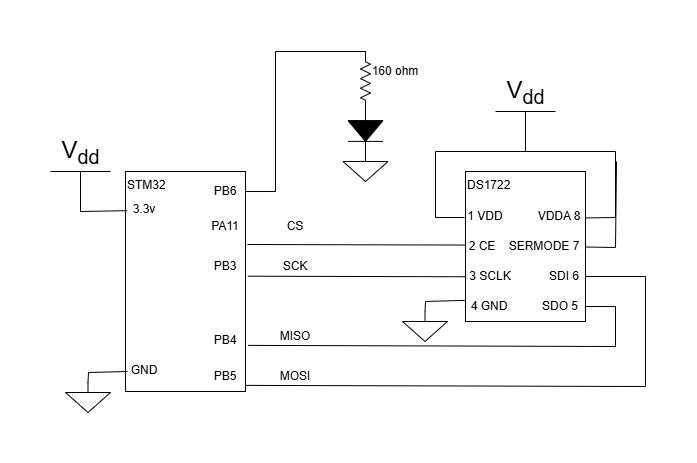
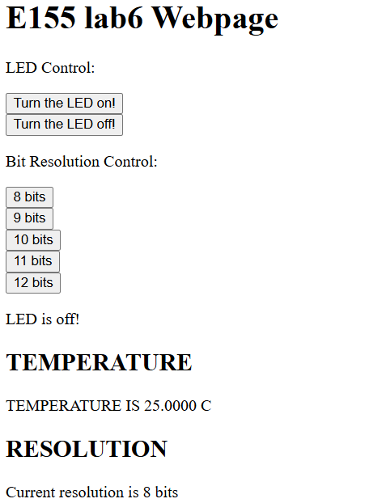
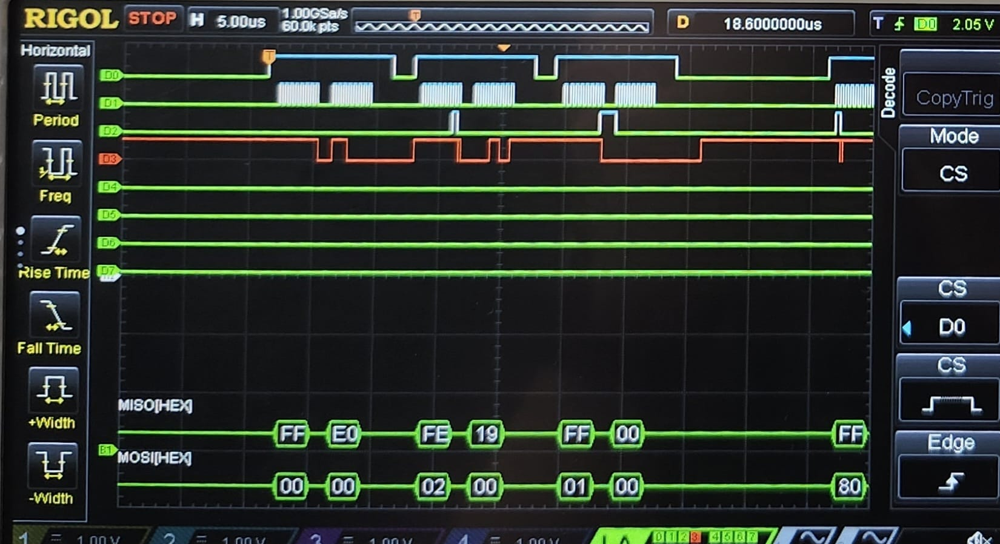
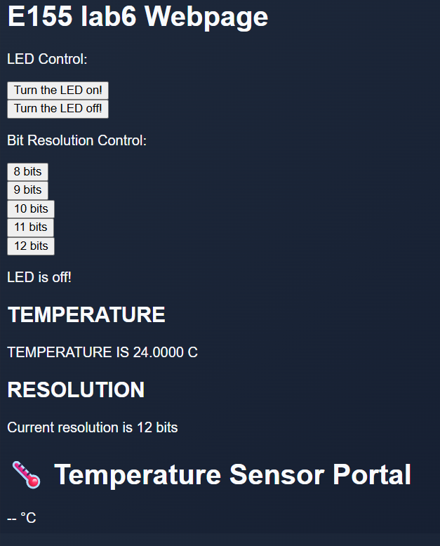
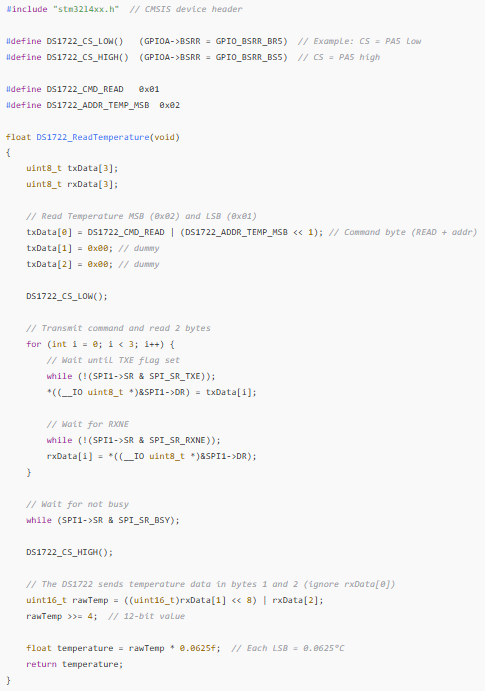

In this lab, we made an IoT device that can control an LED and read temperature from an SPI sensor. The IoT website also has the option to change the resolution, which changes the sensor read time and how precise we can get. The lab worked as intended: the web page could turn the LED on and off, switch between all five resolutions, and display the current temperature.

Spent 19 hours

### Electrical Schematic

### Design Overview

The STM32L432KC communicates with two devices: an ESP8266 over UART (at 125,000 baud), which hosts the web page, and a DS1722 temperature sensor over SPI. When a user opens the page or presses a button, the ESP8266 forwards the request to the MCU as a short `/REQ:<tag>` message. The MCU then:

1. Reads the request one character at a time until it gets a newline.
2. Reads the sensor's configuration, MSB, and LSB registers over SPI.
3. Turns the LED on or off if the request was `ledon` or `ledoff`.
4. Writes a new resolution to the sensor if the request was one of the `8bit` to `12bit` buttons.
5. Sends the full web page back to the ESP8266 with the LED status, temperature, and resolution.

### SPI Configuration

SPI1 was set up as a full-duplex master sending 8-bit frames, MSB first, on PB3 (SCK), PB4 (MISO), and PB5 (MOSI). The DS1722 shifts data out on one clock edge and samples on the other, so we used CPOL = 0 (clock idles low) and CPHA = 1 (data changes on the first edge and is captured on the second). The baud rate field was set to `0b100`, which divides the system clock by 32.

Unlike most SPI devices, the DS1722's chip enable is **active high**. Because of this, the hardware NSS pin was disabled and the chip enable is driven manually on PA11: it goes high before each transaction and low after it. Every transaction is two bytes: first the register address, then either the data to write or a dummy byte to clock out the reply.

### Temperature Resolution

The resolution is set by writing to the sensor's configuration register (write address `0x80`). The sensor starts at 10 bits, and each button on the web page writes a new configuration byte. Higher resolution gives finer temperature steps but takes longer to convert:

| Resolution | Config byte | Step size | Max conversion time |
|---|---|---|---|
| 8 bits  | `0xE0` | 1 °C      | 75 ms   |
| 9 bits  | `0xE2` | 0.5 °C    | 150 ms  |
| 10 bits | `0xE4` | 0.25 °C   | 300 ms  |
| 11 bits | `0xE6` | 0.125 °C  | 600 ms  |
| 12 bits | `0xE8` | 0.0625 °C | 1200 ms |

The temperature is read from the MSB (`0x02`) and LSB (`0x01`) registers. The MSB holds the whole-number part in two's complement, and the top four bits of the LSB hold the fraction. To convert, the two bytes are combined into a 16-bit value and shifted right by 4, which gives a 12-bit two's complement number. If it is negative, the upper bits are filled with ones, and the result is multiplied by 0.0625 °C. At lower resolutions the unused fraction bits are simply 0, so the same formula works for every resolution.

### SPI Transaction Logic Trace

A hex value of 19 is equal to 16 + 9, which is 25 °C, this matches the value we see in the website.

### AI Prototype

The first prompt gave me a decently looking code for a GUI, but it was not functional, I just appended it at the end:

The second prompt gave me a code that looks similar to ours, but it looks a bit shorter than our definitions, so it may not work.

Overall, AI seems to be useful for frameworks like the HTML visual template that looked way better than the one I made, but it would struggle at extremely documentation heavy tasks like coding firmware.

### Resources

Lab 6 code:
<https://github.com/cojedadesilva/E155_Labcode_CODS/tree/main/lab6>
